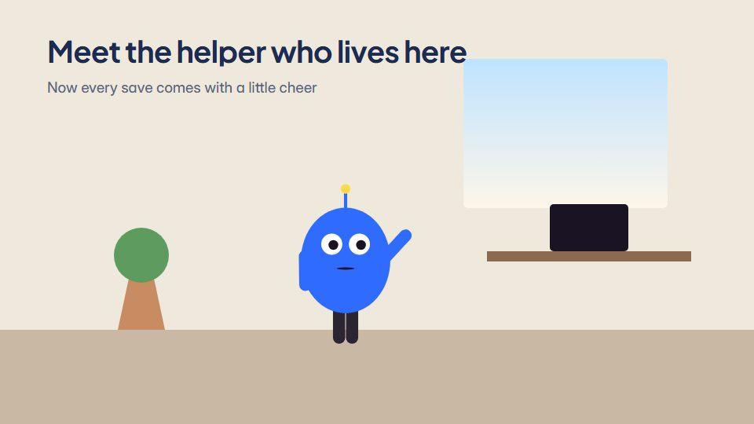

# Mascot-led brand story

**A simple, expressive mascot lives inside the product world and guides the viewer through one real benefit** · Fit for our films: **Adapt: needs a small helper or a stylisation** · Live demo: [`demos/demo.html#mascot-brand-story`](../demos/demo.html#mascot-brand-story)

## The look
A bright brand world in the mascot's colours (#FFF3C4, #FFD84D, #2F6BFF) with the mascot as a rounded character with big expressive eyes; product UI appears as props in the world; soft shadows; friendly rounded type in deep navy (#1D2B53).

## How it moves
The mascot reacts to everything (blinks on the beat, looks at what matters, small hops); product moments are props it uses; the camera keeps its eyes on a third line; it ends with a direct look and the logo.

## Shape of a piece
The mascot at home in the product, a small need, one feature used, delight, the app tease and the name.

## Craft rules
The mascot guides, the user's benefit stays the point; its eyes lead the viewer's attention.

## Ask for, before building
The mascot (art or description), product features as props, tone, end line

## Where it fits
App launch with a mascot, onboarding intro, social brand series, product tips

## Build it with our kit
screencast windows as props, camera with parallax, kinetic text pop, living ground washes, music+SFX

**Small helpers it would want (none built yet; the engine is unchanged):** An eye-and-blink rig; a small squash-and-stretch helper

## Tuning scale
| Energy | Pace | Camera | Density | Background | Type | Realism | Sound |
|---|---|---|---|---|---|---|---|
| +1 | 0 | 0 | 0 | +1 | 0 | −1 | +1 |

## Our director prompt
Direct this film (or these segments) in the **Mascot-led brand story** style. Follow the script word for word, time everything to the voiceover clock, and show me the storyboard before building.

- **Look:** A bright brand world in the mascot's colours (#FFF3C4, #FFD84D, #2F6BFF) with the mascot as a rounded character with big expressive eyes; product UI appears as props in the world; soft shadows; friendly rounded type in deep navy (#1D2B53).
- **Motion:** The mascot reacts to everything (blinks on the beat, looks at what matters, small hops); product moments are props it uses; the camera keeps its eyes on a third line; it ends with a direct look and the logo.
- **Shape of the piece:** The mascot at home in the product, a small need, one feature used, delight, the app tease and the name.
- **Rules:** The mascot guides, the user's benefit stays the point; its eyes lead the viewer's attention.
- **Ask me first for:** the mascot (art or description), product features as props, tone, end line
- **Tuning scale:** Energy +1, Pace 0, Camera 0, Density 0, Background +1, Type 0, Realism −1, Sound +1.
- **Build it with:** screencast windows as props, camera with parallax, kinetic text pop, living ground washes, music+SFX. Keep to the engine's craft rules: one primary mover, scenes that open sparse and build, text that is readable before anything ornamental moves.
