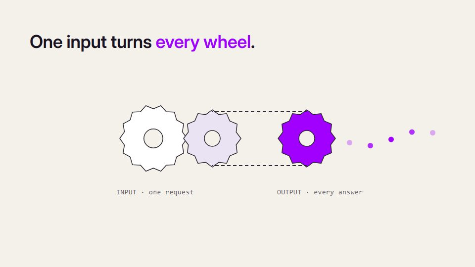

# Diagrammatic concept / mechanism explainer

**Systems, algorithms, science and proofs shown as working machines or diagrams** · Fit for our films: **Ready: our kit builds it today** · Live demo: [`demos/demo.html#mechanism-explainer`](../demos/demo.html#mechanism-explainer)

## The look
Porcelain or dark ground, graphite lines, one working colour and one warning colour, a tabular mono for calculations, a heavy grotesque for statements. Diagrams look like engraved instruments, not clip art.

## How it moves
Every mechanical action corresponds to a step in the argument: wheels lock, a belt couples them, a single unit advances the output, gates show remainders. Simulate the real thing where it is cheap (a genuine random walk rather than a drawing of one), seeded so it stays deterministic.

## Shape of a piece
Claim, setup, operation 1..n, the twist, the general statement, a reset to the opening.

## Craft rules
The mechanism demonstrates; it does not decorate. Copy is locked and never overclaims.

## Ask for, before building
The exact argument steps, one worked example, what must not be claimed.

## Where it fits
"how it works", architecture explainers, security and compliance concepts.

## Build it with our kit
hand-drawn arrows, isometric, data pieces, kinetic text, camera.

**Small helpers it would want (none built yet; the engine is unchanged):** Small mechanism primitives (gear, belt, gate, rack, pipe) with linked rotation; a seeded-random helper; simple maths typesetting.

## Tuning scale
| Energy | Pace | Camera | Density | Background | Type | Realism | Sound |
|---|---|---|---|---|---|---|---|
| −1 | −1 | 0 | 0 | −1 | 0 | −1 | −1 |

## Our director prompt
Direct this film (or these segments) in the **Diagrammatic concept / mechanism explainer** style. Follow the script word for word, time everything to the voiceover clock, and show me the storyboard before building.

- **Look:** porcelain or dark ground, graphite lines, one working colour and one warning colour, a tabular mono for calculations, a heavy grotesque for statements. Diagrams look like engraved instruments, not clip art.
- **Motion:** every mechanical action corresponds to a step in the argument: wheels lock, a belt couples them, a single unit advances the output, gates show remainders. Simulate the real thing where it is cheap (a genuine random walk rather than a drawing of one), seeded so it stays deterministic.
- **Shape of the piece:** claim, setup, operation 1..n, the twist, the general statement, a reset to the opening.
- **Rules:** the mechanism demonstrates; it does not decorate. Copy is locked and never overclaims.
- **Ask me first for:** the exact argument steps, one worked example, what must not be claimed.
- **Tuning scale:** Energy −1, Pace −1, Camera 0, Density 0, Background −1, Type 0, Realism −1, Sound −1.
- **Build it with:** hand-drawn arrows, isometric, data pieces, kinetic text, camera.. Keep to the engine's craft rules: one primary mover, scenes that open sparse and build, text that is readable before anything ornamental moves.
