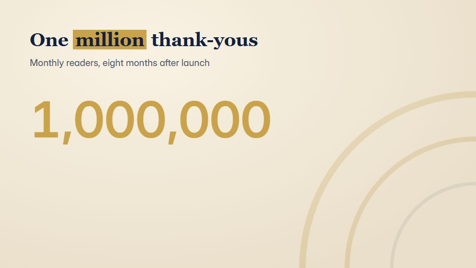

# Milestone number reveal

**A celebration film for one big number: a milestone, an anniversary or a user count, set like gold foil** · Fit for our films: **Ready: our kit builds it today** · Live demo: [`demos/demo.html#milestone-number-reveal`](../demos/demo.html#milestone-number-reveal)

## The look
Warm cream (#F6EEDC) and deep navy (#13213F) with foil gold (#C9A24A); the number set in a sharp high-contrast serif, small caps for labels; fine line-and-dot confetti, ribbon shapes.

## How it moves
The number counts up and lands with a slow overshoot, a foil sheen passes over it, ribbons unfurl from behind, then a short thank-you line rises.

## Shape of a piece
A teaser line, the count-up, the number locks with sheen, two supporting facts, thank-you and logo.

## Craft rules
One number per film; the count ends on the true figure and holds for at least 1.5 s.

## Ask for, before building
The exact milestone figure, what it counts, two supporting facts, thank-you line, logo

## Where it fits
Company anniversary, user or revenue milestone, customer thank-you, internal celebration

## Build it with our kit
data counters, kinetic text rise, living ground sweeps, hand-drawn strokes (ribbons), music+SFX

**Small helpers it would want (none built yet; the engine is unchanged):** A foil-sheen text gradient

## Tuning scale
| Energy | Pace | Camera | Density | Background | Type | Realism | Sound |
|---|---|---|---|---|---|---|---|
| +1 | 0 | 0 | −1 | 0 | +1 | −1 | +1 |

## Our director prompt
Direct this film (or these segments) in the **Milestone number reveal** style. Follow the script word for word, time everything to the voiceover clock, and show me the storyboard before building.

- **Look:** Warm cream (#F6EEDC) and deep navy (#13213F) with foil gold (#C9A24A); the number set in a sharp high-contrast serif, small caps for labels; fine line-and-dot confetti, ribbon shapes.
- **Motion:** The number counts up and lands with a slow overshoot, a foil sheen passes over it, ribbons unfurl from behind, then a short thank-you line rises.
- **Shape of the piece:** A teaser line, the count-up, the number locks with sheen, two supporting facts, thank-you and logo.
- **Rules:** One number per film; the count ends on the true figure and holds for at least 1.5 s.
- **Ask me first for:** the exact milestone figure, what it counts, two supporting facts, thank-you line, logo
- **Tuning scale:** Energy +1, Pace 0, Camera 0, Density −1, Background 0, Type +1, Realism −1, Sound +1.
- **Build it with:** data counters, kinetic text rise, living ground sweeps, hand-drawn strokes (ribbons), music+SFX. Keep to the engine's craft rules: one primary mover, scenes that open sparse and build, text that is readable before anything ornamental moves.
