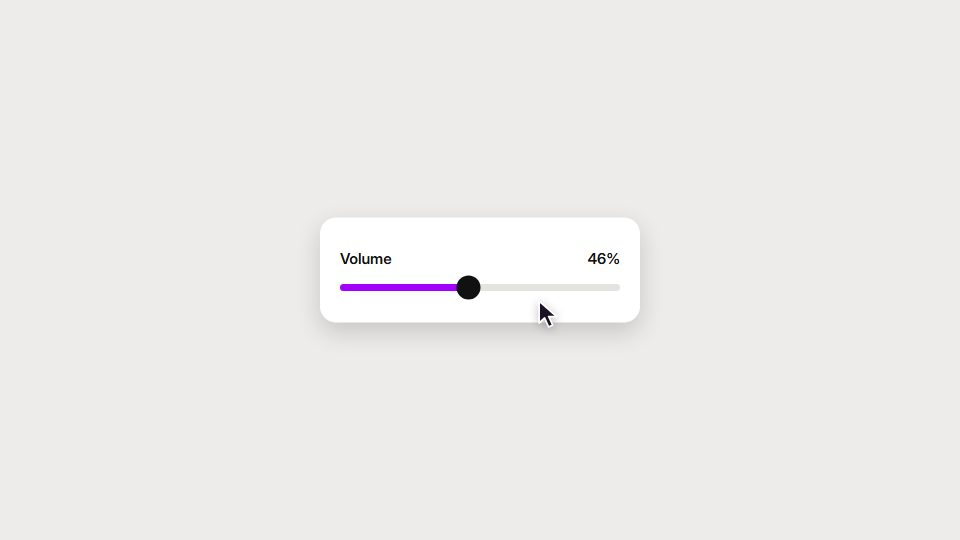

# Morphing-shape UI loop

**One rounded shape turns into button, loader, player, slider, toast and back, driven by a cursor on a beat grid** · Fit for our films: **Adapt: needs a small helper or a stylisation** · Live demo: [`demos/demo.html#morph-ui-loop`](../demos/demo.html#morph-ui-loop)

## The look
Warm light-grey stage, black-and-white components, one accent, one clean grotesque, consistent icon strokes, soft shadows that grow as a shape "lifts". No gradients on the UI chrome.

## How it moves
One persistent rounded rectangle changes width, height, radius and colour through every state, while its content swaps behind a short blur. A cursor causes every change. Indicators stretch because their two edges ride different springs. Drags follow the cursor, then spring from the release. The camera keeps each state at about half the frame and settles more slowly than the shape.

## Shape of a piece
Shape, click, loader, check, widget, slider with an over-drag rubber-band, toggle, tabs, a self-drawing chart with tooltip, command palette, toast, back to the shape. Something lands on every beat.

## Craft rules
Content enters after a morph starts and leaves before the next. Never fade dark into the accent; carry an accent element instead. Overshoot stays tiny.

## Ask for, before building
8–12 real UI states with real data, accent colour, fonts, the product's own components.

## Where it fits
Feature-launch micro-films, a 10–15 s product signature, a social cut of a walkthrough.

## Build it with our kit
screencast parts (buttons, lists, modals, toasts, typed inputs, cursor), camera push-ins, word swaps.

**Small helpers it would want (none built yet; the engine is unchanged):** A closed-form spring helper; a "morph box" (rect whose geometry and colour are spring chains, with its own content clip); a two-edge stretch indicator; a drag-and-release helper.

## Tuning scale
| Energy | Pace | Camera | Density | Background | Type | Realism | Sound |
|---|---|---|---|---|---|---|---|
| +1 | +1 | +1 | −1 | −2 | 0 | 0 | +1 |

## Our director prompt
Direct this film (or these segments) in the **Morphing-shape UI loop** style. Follow the script word for word, time everything to the voiceover clock, and show me the storyboard before building.

- **Look:** warm light-grey stage, black-and-white components, one accent, one clean grotesque, consistent icon strokes, soft shadows that grow as a shape "lifts". No gradients on the UI chrome.
- **Motion:** one persistent rounded rectangle changes width, height, radius and colour through every state, while its content swaps behind a short blur. A cursor causes every change. Indicators stretch because their two edges ride different springs. Drags follow the cursor, then spring from the release. The camera keeps each state at about half the frame and settles more slowly than the shape.
- **Shape of the piece:** shape, click, loader, check, widget, slider with an over-drag rubber-band, toggle, tabs, a self-drawing chart with tooltip, command palette, toast, back to the shape. Something lands on every beat.
- **Rules:** content enters after a morph starts and leaves before the next. Never fade dark into the accent; carry an accent element instead. Overshoot stays tiny.
- **Ask me first for:** 8–12 real UI states with real data, accent colour, fonts, the product's own components.
- **Tuning scale:** Energy +1, Pace +1, Camera +1, Density −1, Background −2, Type 0, Realism 0, Sound +1.
- **Build it with:** screencast parts (buttons, lists, modals, toasts, typed inputs, cursor), camera push-ins, word swaps.. Keep to the engine's craft rules: one primary mover, scenes that open sparse and build, text that is readable before anything ornamental moves.
