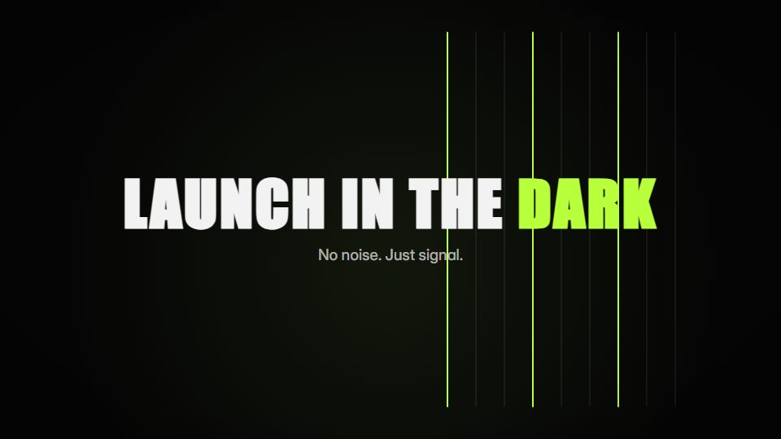

# Neon-signal noir

**Black night frames lit only by one neon edge colour, with terse condensed type like a trailer** · Fit for our films: **Adapt: needs a small helper or a stylisation** · Live demo: [`demos/demo.html#neon-signal-noir`](../demos/demo.html#neon-signal-noir)

## The look
Black (#050505) with a single electric green (#B8FF3C) or magenta (#FF2BD6), never both; condensed bold caps; thin neon outlines that glow and reflect faintly below; deep vignette and grain.

## How it moves
A neon line traces the frame and bends into the next shape; words strike on the beat and leave with a quick blur; slow pushes between hits; a slight print offset only on impact frames.

## Shape of a piece
Darkness and one humming line, three short claims, the product outlined in neon, the name flickers on.

## Craft rules
One hue, used as light rather than fill; avoid space clichés and stock AI imagery.

## Ask for, before building
Brand neon colour, 3 punchy lines, product silhouette or screen, logo

## Where it fits
Bold startup launch, event or hackathon promo, recruiting teaser

## Build it with our kit
kinetic text pop and blur, hand-drawn strokes (glowing), living ground rays, shader grain, music+SFX

**Small helpers it would want (none built yet; the engine is unchanged):** A glow stroke (blurred copy under a crisp line)

## Tuning scale
| Energy | Pace | Camera | Density | Background | Type | Realism | Sound |
|---|---|---|---|---|---|---|---|
| +2 | +1 | +1 | −1 | 0 | +2 | −1 | +2 |

## Our director prompt
Direct this film (or these segments) in the **Neon-signal noir** style. Follow the script word for word, time everything to the voiceover clock, and show me the storyboard before building.

- **Look:** Black (#050505) with a single electric green (#B8FF3C) or magenta (#FF2BD6), never both; condensed bold caps; thin neon outlines that glow and reflect faintly below; deep vignette and grain.
- **Motion:** A neon line traces the frame and bends into the next shape; words strike on the beat and leave with a quick blur; slow pushes between hits; a slight print offset only on impact frames.
- **Shape of the piece:** Darkness and one humming line, three short claims, the product outlined in neon, the name flickers on.
- **Rules:** One hue, used as light rather than fill; avoid space clichés and stock AI imagery.
- **Ask me first for:** brand neon colour, 3 punchy lines, product silhouette or screen, logo
- **Tuning scale:** Energy +2, Pace +1, Camera +1, Density −1, Background 0, Type +2, Realism −1, Sound +2.
- **Build it with:** kinetic text pop and blur, hand-drawn strokes (glowing), living ground rays, shader grain, music+SFX. Keep to the engine's craft rules: one primary mover, scenes that open sparse and build, text that is readable before anything ornamental moves.
