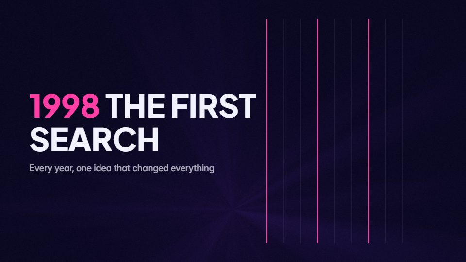

# Neon-year chronicle

**History told in punches: glowing year numerals swing in with a twist, and each year's event is sketched in white line art** · Fit for our films: **Ready: our kit builds it today** · Live demo: [`demos/demo.html#neon-year-chronicle`](../demos/demo.html#neon-year-chronicle)

## The look
Midnight (#0A0820) with neon numerals in pink and cyan (#FF3EA5, #36E2FF) and thin white line drawings (#F2F2FF); a wide display sans for years, a clean grotesque for one-line events.

## How it moves
Each year swings in with a turn that feels 3D and lands hard on a beat, its event drawing on beside it, then the next year knocks it away; the pace quickens toward the present.

## Shape of a piece
The first year, 6-10 year beats, a pause at the turning point, today, the forward line.

## Craft rules
Pacing beats information: one event per year and one line each.

## Ask for, before building
The years and one-line events, the turning point, the closing line

## Where it fits
Company story in 30 s, product evolution, industry recap, launch context opener

## Build it with our kit
kinetic text pop and drop, hand-drawn strokes, living ground rays, camera, music+SFX

**Small helpers it would want (none built yet; the engine is unchanged):** A fake-3D flip for numerals (scale and skew)

## Tuning scale
| Energy | Pace | Camera | Density | Background | Type | Realism | Sound |
|---|---|---|---|---|---|---|---|
| +2 | +2 | +1 | 0 | 0 | +2 | −1 | +2 |

## Our director prompt
Direct this film (or these segments) in the **Neon-year chronicle** style. Follow the script word for word, time everything to the voiceover clock, and show me the storyboard before building.

- **Look:** Midnight (#0A0820) with neon numerals in pink and cyan (#FF3EA5, #36E2FF) and thin white line drawings (#F2F2FF); a wide display sans for years, a clean grotesque for one-line events.
- **Motion:** Each year swings in with a turn that feels 3D and lands hard on a beat, its event drawing on beside it, then the next year knocks it away; the pace quickens toward the present.
- **Shape of the piece:** The first year, 6-10 year beats, a pause at the turning point, today, the forward line.
- **Rules:** Pacing beats information: one event per year and one line each.
- **Ask me first for:** the years and one-line events, the turning point, the closing line
- **Tuning scale:** Energy +2, Pace +2, Camera +1, Density 0, Background 0, Type +2, Realism −1, Sound +2.
- **Build it with:** kinetic text pop and drop, hand-drawn strokes, living ground rays, camera, music+SFX. Keep to the engine's craft rules: one primary mover, scenes that open sparse and build, text that is readable before anything ornamental moves.
