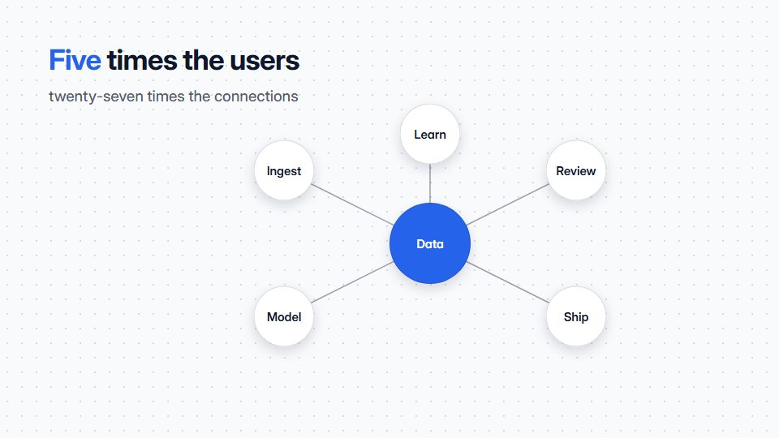

# Network-effect growth diagram

**Nodes multiply and connections explode, with a live counter showing links outgrowing users** · Fit for our films: **Ready: our kit builds it today** · Live demo: [`demos/demo.html#network-growth`](../demos/demo.html#network-growth)

## The look
Near-white (#F8FAFC) with ink (#0F172A); nodes as small filled circles (#2563EB), links as thin lines whose opacity rises with density, one highlight (#F43F5E) for new links; a large counter in a clean grotesque.

## How it moves
Each step adds users and their links draw in quickly behind them; the counter jumps and the camera pulls back to keep the web framed; a slider-like control shows the input value.

## Shape of a piece
Two users and one link, growth steps (five times the users, far more links), the comparison line, what it means for the business.

## Craft rules
Counts must be mathematically right; links draw fast enough to feel exponential but never flicker.

## Ask for, before building
The growth rule, real numbers if available, the business takeaway

## Where it fits
Marketplace or platform pitch, investor film, community or ecosystem story

## Build it with our kit
diagram strokes, data counters, living ground dots, camera pull, kinetic text

**Small helpers it would want (none built yet; the engine is unchanged):** A node-link generator with a deterministic layout

## Tuning scale
| Energy | Pace | Camera | Density | Background | Type | Realism | Sound |
|---|---|---|---|---|---|---|---|
| 0 | 0 | +1 | +1 | −1 | 0 | −2 | 0 |

## Our director prompt
Direct this film (or these segments) in the **Network-effect growth diagram** style. Follow the script word for word, time everything to the voiceover clock, and show me the storyboard before building.

- **Look:** Near-white (#F8FAFC) with ink (#0F172A); nodes as small filled circles (#2563EB), links as thin lines whose opacity rises with density, one highlight (#F43F5E) for new links; a large counter in a clean grotesque.
- **Motion:** Each step adds users and their links draw in quickly behind them; the counter jumps and the camera pulls back to keep the web framed; a slider-like control shows the input value.
- **Shape of the piece:** Two users and one link, growth steps (five times the users, far more links), the comparison line, what it means for the business.
- **Rules:** Counts must be mathematically right; links draw fast enough to feel exponential but never flicker.
- **Ask me first for:** the growth rule, real numbers if available, the business takeaway
- **Tuning scale:** Energy 0, Pace 0, Camera +1, Density +1, Background −1, Type 0, Realism −2, Sound 0.
- **Build it with:** diagram strokes, data counters, living ground dots, camera pull, kinetic text. Keep to the engine's craft rules: one primary mover, scenes that open sparse and build, text that is readable before anything ornamental moves.
