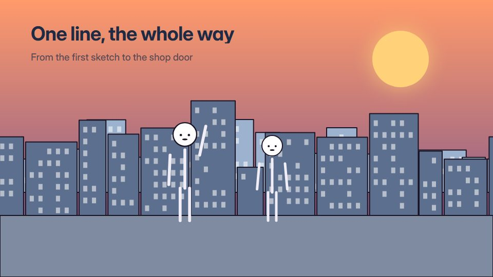

# One continuous line story

**A single line that never lifts draws the whole story, closing round each shape before it floods with pastel colour** · Fit for our films: **Adapt: needs a small helper or a stylisation** · Live demo: [`demos/demo.html#one-line-story`](../demos/demo.html#one-line-story)

## The look
One unbroken line (#1F2A44) on warm off-white (#F7F2EA), with pastel fills (#F6C9B5, #BFD8D2, #F3E3A1) that flood a shape once the line closes it; light old-film grain.

## How it moves
The pen never lifts: it draws a person, closes round them, the fill floods in, then the line runs on and becomes the next object or place. The camera follows the pen tip gently.

## Shape of a piece
The line enters, draws the hero, draws their world, the turning object, the line pulls into the final mark.

## Craft rules
One line, one direction of travel, no cuts; a fill appears only after its shape closes.

## Ask for, before building
Script, the sequence of things the line should become, the final mark

## Where it fits
Brand story or manifesto, founder journey, product-origin story, logo outro

## Build it with our kit
hand-drawn strokes draw-on, camera travel, living ground washes, shader grain, music

**Small helpers it would want (none built yet; the engine is unchanged):** One long progressive path with a camera that follows its tip; fill-on-close

## Tuning scale
| Energy | Pace | Camera | Density | Background | Type | Realism | Sound |
|---|---|---|---|---|---|---|---|
| −1 | −1 | +1 | −2 | −1 | −1 | −2 | −1 |

## Our director prompt
Direct this film (or these segments) in the **One continuous line story** style. Follow the script word for word, time everything to the voiceover clock, and show me the storyboard before building.

- **Look:** One unbroken line (#1F2A44) on warm off-white (#F7F2EA), with pastel fills (#F6C9B5, #BFD8D2, #F3E3A1) that flood a shape once the line closes it; light old-film grain.
- **Motion:** The pen never lifts: it draws a person, closes round them, the fill floods in, then the line runs on and becomes the next object or place. The camera follows the pen tip gently.
- **Shape of the piece:** The line enters, draws the hero, draws their world, the turning object, the line pulls into the final mark.
- **Rules:** One line, one direction of travel, no cuts; a fill appears only after its shape closes.
- **Ask me first for:** script, the sequence of things the line should become, the final mark
- **Tuning scale:** Energy −1, Pace −1, Camera +1, Density −2, Background −1, Type −1, Realism −2, Sound −1.
- **Build it with:** hand-drawn strokes draw-on, camera travel, living ground washes, shader grain, music. Keep to the engine's craft rules: one primary mover, scenes that open sparse and build, text that is readable before anything ornamental moves.
