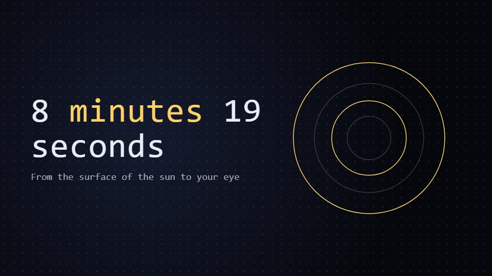

# One-traveller journey clock

**Follow a single particle, packet or parcel from start to finish while a running clock shows the real elapsed time** · Fit for our films: **Adapt: needs a small helper or a stylisation** · Live demo: [`demos/demo.html#one-traveller-journey`](../demos/demo.html#one-traveller-journey)

## The look
Deep space-black (#06070C) with one bright traveller (#FFD166) trailing a short tail, landmarks as simple outlined rings (#5E6A8A), a mono clock and distance counter in a fixed corner; labels in a light grotesque.

## How it moves
The camera rides with the traveller, easing down at each landmark for a label and speeding up between them; the clock runs or jumps to show true times (seconds, minutes, years).

## Shape of a piece
The origin, 3-5 waypoints with real times, the surprising longest leg, arrival at the viewer or customer, the takeaway.

## Craft rules
Times and distances are real and the clock is always visible; one traveller only.

## Ask for, before building
The journey stops, real times or distances, the arrival point, takeaway

## Where it fits
Network or latency story, logistics journey, what-happens-when-you-click explainer

## Build it with our kit
camera travel, data counters, living ground rings and dots, kinetic text, music+SFX

**Small helpers it would want (none built yet; the engine is unchanged):** A path-follow helper with eased speed per segment

## Tuning scale
| Energy | Pace | Camera | Density | Background | Type | Realism | Sound |
|---|---|---|---|---|---|---|---|
| 0 | 0 | +2 | −1 | 0 | 0 | −1 | 0 |

## Our director prompt
Direct this film (or these segments) in the **One-traveller journey clock** style. Follow the script word for word, time everything to the voiceover clock, and show me the storyboard before building.

- **Look:** Deep space-black (#06070C) with one bright traveller (#FFD166) trailing a short tail, landmarks as simple outlined rings (#5E6A8A), a mono clock and distance counter in a fixed corner; labels in a light grotesque.
- **Motion:** The camera rides with the traveller, easing down at each landmark for a label and speeding up between them; the clock runs or jumps to show true times (seconds, minutes, years).
- **Shape of the piece:** The origin, 3-5 waypoints with real times, the surprising longest leg, arrival at the viewer or customer, the takeaway.
- **Rules:** Times and distances are real and the clock is always visible; one traveller only.
- **Ask me first for:** the journey stops, real times or distances, the arrival point, takeaway
- **Tuning scale:** Energy 0, Pace 0, Camera +2, Density −1, Background 0, Type 0, Realism −1, Sound 0.
- **Build it with:** camera travel, data counters, living ground rings and dots, kinetic text, music+SFX. Keep to the engine's craft rules: one primary mover, scenes that open sparse and build, text that is readable before anything ornamental moves.
