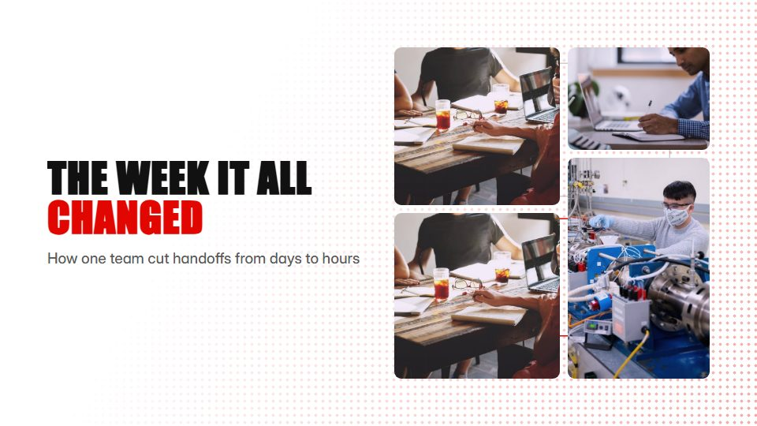

# Comic-panel case story

**A customer story laid out as a page of comic panels that open one by one, with caption boxes and one accent colour** · Fit for our films: **Adapt: needs a small helper or a stylisation** · Live demo: [`demos/demo.html#panel-grid-story`](../demos/demo.html#panel-grid-story)

## The look
White page (#FFFFFF) with black gutters and borders (#111111); panels hold greyscale photos or flat drawings with light screentone; one accent (#E10600) on the key object; square caption boxes in a condensed sans.

## How it moves
Panels pop open in reading order; the camera glides between them and punches into one for the key moment; hard cuts between panels, then the last panel grows to full frame for the payoff.

## Shape of a piece
The setup panel, the problem, the turning point, the result, a full-bleed final panel with the line.

## Craft rules
Reading order must be obvious (left to right, top to bottom); one accent object; captions stay short.

## Ask for, before building
The story in 4-6 moments, photos or drawings for each, the payoff line

## Where it fits
Customer case study, incident or post-mortem story, onboarding story

## Build it with our kit
real photos, camera travel and push-ins, kinetic text, shader halftone (screentone), living ground

**Small helpers it would want (none built yet; the engine is unchanged):** A panel-layout helper with gutters

## Tuning scale
| Energy | Pace | Camera | Density | Background | Type | Realism | Sound |
|---|---|---|---|---|---|---|---|
| 0 | 0 | +1 | +1 | −1 | +1 | 0 | 0 |

## Our director prompt
Direct this film (or these segments) in the **Comic-panel case story** style. Follow the script word for word, time everything to the voiceover clock, and show me the storyboard before building.

- **Look:** White page (#FFFFFF) with black gutters and borders (#111111); panels hold greyscale photos or flat drawings with light screentone; one accent (#E10600) on the key object; square caption boxes in a condensed sans.
- **Motion:** Panels pop open in reading order; the camera glides between them and punches into one for the key moment; hard cuts between panels, then the last panel grows to full frame for the payoff.
- **Shape of the piece:** The setup panel, the problem, the turning point, the result, a full-bleed final panel with the line.
- **Rules:** Reading order must be obvious (left to right, top to bottom); one accent object; captions stay short.
- **Ask me first for:** the story in 4-6 moments, photos or drawings for each, the payoff line
- **Tuning scale:** Energy 0, Pace 0, Camera +1, Density +1, Background −1, Type +1, Realism 0, Sound 0.
- **Build it with:** real photos, camera travel and push-ins, kinetic text, shader halftone (screentone), living ground. Keep to the engine's craft rules: one primary mover, scenes that open sparse and build, text that is readable before anything ornamental moves.
