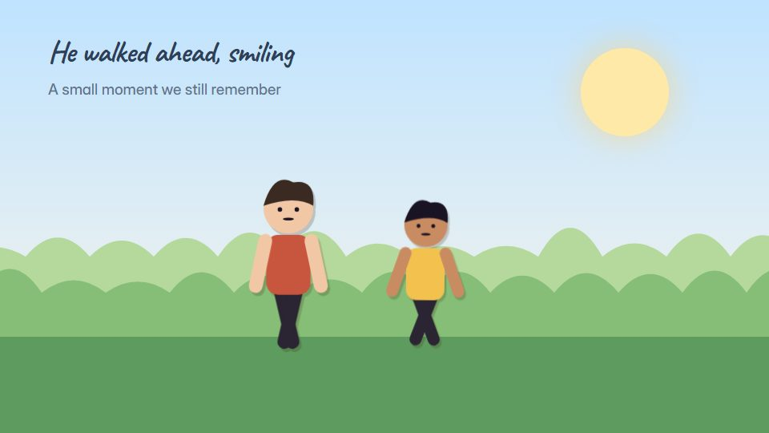

# Paper cut-out puppets

**Jointed card puppets on layered paper sets, moving with a stiff, charming stroll** · Fit for our films: **Adapt: needs a small helper or a stylisation** · Live demo: [`demos/demo.html#paper-puppet-stroll`](../demos/demo.html#paper-puppet-stroll)

## The look
Cut card in warm, slightly faded colours (#E9D8B4, #C8553D, #2E4057, #F2C14E) with visible fibre, deckled edges and soft drop shadows; split-pin joints at shoulders and knees; hand-lettered or typewriter captions.

## How it moves
Puppets move only at their joints, limbs swinging round pins while bodies bob; backgrounds slide as stacked card sheets; an occasional step on twos adds a handmade feel.

## Shape of a piece
The paper stage, the hero strolls in, an everyday moment, a small surprise, a warm close.

## Craft rules
Joints rotate, limbs never bend; shadows stay consistent so the layers read as real paper.

## Ask for, before building
Script, 2-3 characters, setting, palette, caption lines

## Where it fits
People and culture story, anecdote-led founder story, holiday message, internal comms

## Build it with our kit
camera with parallax (layer slides), shader grain, living ground paper, kinetic text, music

**Small helpers it would want (none built yet; the engine is unchanged):** A jointed puppet rig with pivot points; a deckled-edge paper mask

## Tuning scale
| Energy | Pace | Camera | Density | Background | Type | Realism | Sound |
|---|---|---|---|---|---|---|---|
| −1 | −1 | 0 | 0 | 0 | −1 | −1 | −1 |

## Our director prompt
Direct this film (or these segments) in the **Paper cut-out puppets** style. Follow the script word for word, time everything to the voiceover clock, and show me the storyboard before building.

- **Look:** Cut card in warm, slightly faded colours (#E9D8B4, #C8553D, #2E4057, #F2C14E) with visible fibre, deckled edges and soft drop shadows; split-pin joints at shoulders and knees; hand-lettered or typewriter captions.
- **Motion:** Puppets move only at their joints, limbs swinging round pins while bodies bob; backgrounds slide as stacked card sheets; an occasional step on twos adds a handmade feel.
- **Shape of the piece:** The paper stage, the hero strolls in, an everyday moment, a small surprise, a warm close.
- **Rules:** Joints rotate, limbs never bend; shadows stay consistent so the layers read as real paper.
- **Ask me first for:** script, 2-3 characters, setting, palette, caption lines
- **Tuning scale:** Energy −1, Pace −1, Camera 0, Density 0, Background 0, Type −1, Realism −1, Sound −1.
- **Build it with:** camera with parallax (layer slides), shader grain, living ground paper, kinetic text, music. Keep to the engine's craft rules: one primary mover, scenes that open sparse and build, text that is readable before anything ornamental moves.
