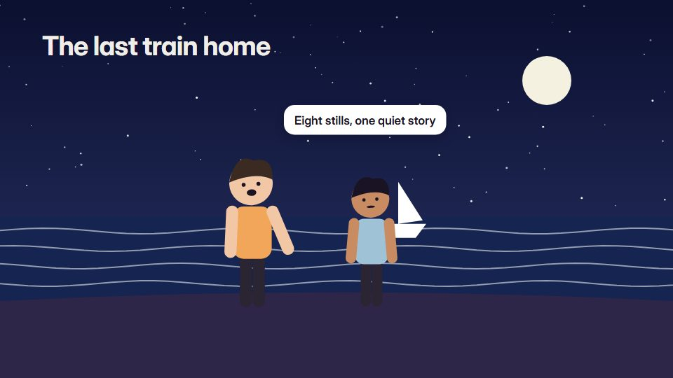

# Parallax picture story

**Supplied illustrations or photos split into depth layers and moved in slow 2.5D, with one living detail per still** · Fit for our films: **Ready: our kit builds it today** · Live demo: [`demos/demo.html#parallax-picture-story`](../demos/demo.html#parallax-picture-story)

## The look
Stills cut into 3-5 layers (foreground, character, middle, background, sky) with atmospheric haze on far layers (#1C2A3A to #8A9BA8), subtle grain and one accent light (#F2A65A).

## How it moves
Slow 2.5D moves through the layers (push, crane, sideways dolly) with small secondary motion inside each still (hair, rain, steam, a blinking sign); cuts land on story beats.

## Shape of a piece
An establishing still with depth, 4-8 story stills each with one move and one living detail, a final held image.

## Craft rules
One camera move per still and believable parallax (near layers move most); never stretch a layer past its edge.

## Ask for, before building
The illustrations or photos (layered if possible), the script, which detail moves in each

## Where it fits
Story-led campaign from existing art, customer story from photos, history or heritage film

## Build it with our kit
camera with parallax, real photos, living ground washes, shader grain, kinetic text, music+SFX

**Small helpers it would want (none built yet; the engine is unchanged):** A layer-stack helper (depth and haze per layer); small looping secondary motion

## Tuning scale
| Energy | Pace | Camera | Density | Background | Type | Realism | Sound |
|---|---|---|---|---|---|---|---|
| −1 | −1 | +2 | 0 | 0 | −1 | +1 | 0 |

## Our director prompt
Direct this film (or these segments) in the **Parallax picture story** style. Follow the script word for word, time everything to the voiceover clock, and show me the storyboard before building.

- **Look:** Stills cut into 3-5 layers (foreground, character, middle, background, sky) with atmospheric haze on far layers (#1C2A3A to #8A9BA8), subtle grain and one accent light (#F2A65A).
- **Motion:** Slow 2.5D moves through the layers (push, crane, sideways dolly) with small secondary motion inside each still (hair, rain, steam, a blinking sign); cuts land on story beats.
- **Shape of the piece:** An establishing still with depth, 4-8 story stills each with one move and one living detail, a final held image.
- **Rules:** One camera move per still and believable parallax (near layers move most); never stretch a layer past its edge.
- **Ask me first for:** the illustrations or photos (layered if possible), the script, which detail moves in each
- **Tuning scale:** Energy −1, Pace −1, Camera +2, Density 0, Background 0, Type −1, Realism +1, Sound 0.
- **Build it with:** camera with parallax, real photos, living ground washes, shader grain, kinetic text, music+SFX. Keep to the engine's craft rules: one primary mover, scenes that open sparse and build, text that is readable before anything ornamental moves.
