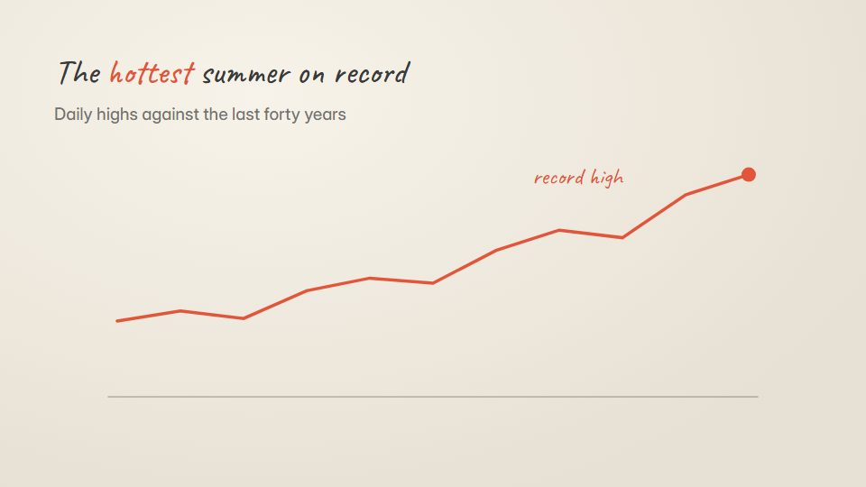

# Pencil-sketch data story

**Real data drawn as if by hand in graphite and coloured pencil, with a faint colour fringe for a modern edge** · Fit for our films: **Adapt: needs a small helper or a stylisation** · Live demo: [`demos/demo.html#pencil-sketch-data`](../demos/demo.html#pencil-sketch-data)

## The look
Off-white drawing paper (#F3EFE6) with graphite (#3A3A3A) and two pencil colours (#E2553A, #3A7BD5); wobbly hand-drawn axes, hatched fills, handwritten notes, a very slight red/cyan fringe on strokes.

## How it moves
Axes sketch on, a trend line is drawn with a small tremble, hatching fills areas line by line, notes write themselves beside the key points; the camera slides along a long chart like a sheet on a desk.

## Shape of a piece
The question in handwriting, the baseline chart sketches on, the outlier year is circled, comparison with other years, the takeaway written large.

## Craft rules
The look is hand-drawn but the data is exact: values sit at true positions even when the line wobbles. Keep the fringe tiny.

## Ask for, before building
The dataset and source, the outlier to highlight, the takeaway sentence

## Where it fits
Research findings, sustainability or climate report, survey results, thought-leadership film

## Build it with our kit
hand-drawn strokes and handwriting, data line and bars, data notes (hand), living ground paper, camera slide

**Small helpers it would want (none built yet; the engine is unchanged):** A hatching fill; a chromatic-fringe offset for strokes

## Tuning scale
| Energy | Pace | Camera | Density | Background | Type | Realism | Sound |
|---|---|---|---|---|---|---|---|
| −1 | −1 | +1 | +1 | 0 | 0 | −1 | −1 |

## Our director prompt
Direct this film (or these segments) in the **Pencil-sketch data story** style. Follow the script word for word, time everything to the voiceover clock, and show me the storyboard before building.

- **Look:** Off-white drawing paper (#F3EFE6) with graphite (#3A3A3A) and two pencil colours (#E2553A, #3A7BD5); wobbly hand-drawn axes, hatched fills, handwritten notes, a very slight red/cyan fringe on strokes.
- **Motion:** Axes sketch on, a trend line is drawn with a small tremble, hatching fills areas line by line, notes write themselves beside the key points; the camera slides along a long chart like a sheet on a desk.
- **Shape of the piece:** The question in handwriting, the baseline chart sketches on, the outlier year is circled, comparison with other years, the takeaway written large.
- **Rules:** The look is hand-drawn but the data is exact: values sit at true positions even when the line wobbles. Keep the fringe tiny.
- **Ask me first for:** the dataset and source, the outlier to highlight, the takeaway sentence
- **Tuning scale:** Energy −1, Pace −1, Camera +1, Density +1, Background 0, Type 0, Realism −1, Sound −1.
- **Build it with:** hand-drawn strokes and handwriting, data line and bars, data notes (hand), living ground paper, camera slide. Keep to the engine's craft rules: one primary mover, scenes that open sparse and build, text that is readable before anything ornamental moves.
