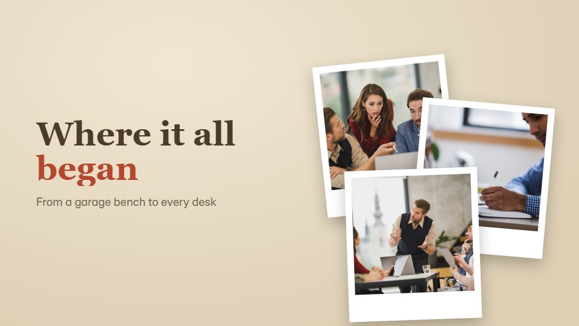

# Period-style chronicle

**Each era is drawn in the design language of its own time, so the look itself travels from vintage print to today** · Fit for our films: **Adapt: needs a small helper or a stylisation** · Live demo: [`demos/demo.html#period-style-chronicle`](../demos/demo.html#period-style-chronicle)

## The look
Opens in sepia print (#E9DCC3, #4A3B2A) with a letterpress serif, passes through bold mid-century colour blocks, a pixel-era screen and glossy chrome, and ends in today's clean UI (#FFFFFF, #111111); every era has its own type.

## How it moves
Transitions are the era changing: paper ages forward, a print shrinks into a screen, a pixel screen sharpens into glass. A steady march with one camera direction throughout.

## Shape of a piece
The origin in vintage style, 3-5 eras each in its own look, the present, a glimpse of what is next.

## Craft rules
Never mix two eras in one frame except mid-transition; copy and layout positions stay constant so only the style changes.

## Ask for, before building
The eras with dates and events, archival photos if any, closing line

## Where it fits
Brand or product evolution, anniversary film, industry history keynote

## Build it with our kit
real photos, kinetic text, shader grain and halftone, continuity moves, living ground

**Small helpers it would want (none built yet; the engine is unchanged):** A per-era theme switch (palette, font, texture) on one timeline

## Tuning scale
| Energy | Pace | Camera | Density | Background | Type | Realism | Sound |
|---|---|---|---|---|---|---|---|
| +1 | 0 | 0 | +1 | +2 | +1 | 0 | 0 |

## Our director prompt
Direct this film (or these segments) in the **Period-style chronicle** style. Follow the script word for word, time everything to the voiceover clock, and show me the storyboard before building.

- **Look:** Opens in sepia print (#E9DCC3, #4A3B2A) with a letterpress serif, passes through bold mid-century colour blocks, a pixel-era screen and glossy chrome, and ends in today's clean UI (#FFFFFF, #111111); every era has its own type.
- **Motion:** Transitions are the era changing: paper ages forward, a print shrinks into a screen, a pixel screen sharpens into glass. A steady march with one camera direction throughout.
- **Shape of the piece:** The origin in vintage style, 3-5 eras each in its own look, the present, a glimpse of what is next.
- **Rules:** Never mix two eras in one frame except mid-transition; copy and layout positions stay constant so only the style changes.
- **Ask me first for:** the eras with dates and events, archival photos if any, closing line
- **Tuning scale:** Energy +1, Pace 0, Camera 0, Density +1, Background +2, Type +1, Realism 0, Sound 0.
- **Build it with:** real photos, kinetic text, shader grain and halftone, continuity moves, living ground. Keep to the engine's craft rules: one primary mover, scenes that open sparse and build, text that is readable before anything ornamental moves.
