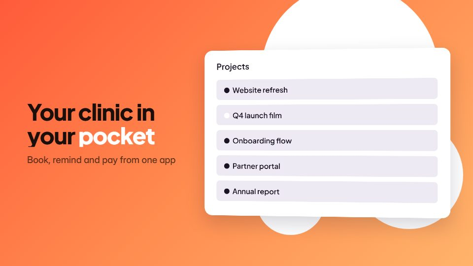

# Floating phone app promo

**Mobile app promo where device frames float on a colour field, turn slightly and swap real screens** · Fit for our films: **Ready: our kit builds it today** · Live demo: [`demos/demo.html#phone-frame-app-promo`](../demos/demo.html#phone-frame-app-promo)

## The look
A saturated warm field (#FF5B3A to #FFB36B) with two or three phone frames in soft shadow, real screenshots inside, a chunky grotesque headline alongside and small rounded pills as feature labels.

## How it moves
Phones glide in at staggered depths and settle with a tiny overshoot; screens slide inside their frames to change; a notification drops from the top; the camera arcs gently round the group.

## Shape of a piece
One phone arrives, three screen swaps each with a pill label, the group fans out, store badges and name.

## Craft rules
Screens are real and readable at final size; frames stay within about 12 degrees of upright, one label per screen.

## Ask for, before building
High-res app screenshots, the three moments to show, store links, brand colours

## Where it fits
Mobile app launch, app-store preview, mobile feature update

## Build it with our kit
screencast windows as device screens, camera with parallax, kinetic text pop, living ground washes, real screenshots, toasts

**Small helpers it would want (none built yet; the engine is unchanged):** A phone-frame wrapper with a screen clip

## Tuning scale
| Energy | Pace | Camera | Density | Background | Type | Realism | Sound |
|---|---|---|---|---|---|---|---|
| +1 | +1 | +1 | 0 | +1 | 0 | +1 | +1 |

## Our director prompt
Direct this film (or these segments) in the **Floating phone app promo** style. Follow the script word for word, time everything to the voiceover clock, and show me the storyboard before building.

- **Look:** A saturated warm field (#FF5B3A to #FFB36B) with two or three phone frames in soft shadow, real screenshots inside, a chunky grotesque headline alongside and small rounded pills as feature labels.
- **Motion:** Phones glide in at staggered depths and settle with a tiny overshoot; screens slide inside their frames to change; a notification drops from the top; the camera arcs gently round the group.
- **Shape of the piece:** One phone arrives, three screen swaps each with a pill label, the group fans out, store badges and name.
- **Rules:** Screens are real and readable at final size; frames stay within about 12 degrees of upright, one label per screen.
- **Ask me first for:** high-res app screenshots, the three moments to show, store links, brand colours
- **Tuning scale:** Energy +1, Pace +1, Camera +1, Density 0, Background +1, Type 0, Realism +1, Sound +1.
- **Build it with:** screencast windows as device screens, camera with parallax, kinetic text pop, living ground washes, real screenshots, toasts. Keep to the engine's craft rules: one primary mover, scenes that open sparse and build, text that is readable before anything ornamental moves.
