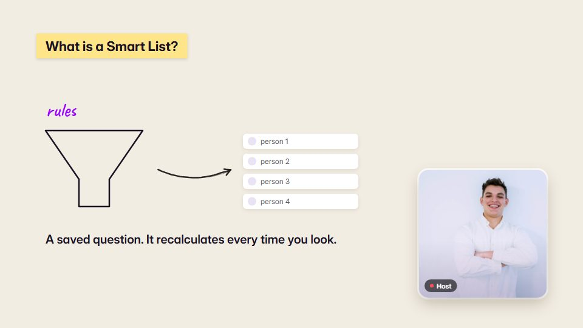

# Talking-head and podcast graphic inserts

**Full-screen explainer cards cut into a recorded conversation, with a speaker in a corner frame** · Fit for our films: **Adapt: needs a small helper or a stylisation** · Live demo: [`demos/demo.html#podcast-inserts`](../demos/demo.html#podcast-inserts)

## The look
A shared style bible across 30–50 inserts (paper, tape labels, halftone print), brand colours, a static logo corner.

## How it moves
An insert covers a stretch of talk, synced to the spoken words, with the speaker kept in a corner frame following whoever talks. No punch-ins on the faces.

## Shape of a piece
Per insert, 4–10 s: concept title, one diagram build, a pay-off line. Leave a few seconds of faces between inserts.

## Craft rules
Copy is verbatim or faithful, with no invented numbers. Each graphic stays inside one uncut stretch of audio. One judge pass, and only egregious cues are redone.

## Ask for, before building
The recorded cut, the transcript with times, brand kit.

## Where it fits
Webinar and podcast repurposing, customer-interview films, people stories with real footage.

## Build it with our kit
VO clock (word times), kinetic text, data and diagram pieces, real footage.

**Small helpers it would want (none built yet; the engine is unchanged):** A picture-in-picture frame for supplied footage; an insert-list runner (many short segments from one cue file).

## Tuning scale
| Energy | Pace | Camera | Density | Background | Type | Realism | Sound |
|---|---|---|---|---|---|---|---|
| 0 | 0 | −2 | −1 | −1 | 0 | +2 | −1 |

## Our director prompt
Direct this film (or these segments) in the **Talking-head and podcast graphic inserts** style. Follow the script word for word, time everything to the voiceover clock, and show me the storyboard before building.

- **Look:** a shared style bible across 30–50 inserts (paper, tape labels, halftone print), brand colours, a static logo corner.
- **Motion:** an insert covers a stretch of talk, synced to the spoken words, with the speaker kept in a corner frame following whoever talks. No punch-ins on the faces.
- **Shape of the piece:** per insert, 4–10 s: concept title, one diagram build, a pay-off line. Leave a few seconds of faces between inserts.
- **Rules:** copy is verbatim or faithful, with no invented numbers. Each graphic stays inside one uncut stretch of audio. One judge pass, and only egregious cues are redone.
- **Ask me first for:** the recorded cut, the transcript with times, brand kit.
- **Tuning scale:** Energy 0, Pace 0, Camera −2, Density −1, Background −1, Type 0, Realism +2, Sound −1.
- **Build it with:** VO clock (word times), kinetic text, data and diagram pieces, real footage.. Keep to the engine's craft rules: one primary mover, scenes that open sparse and build, text that is readable before anything ornamental moves.
