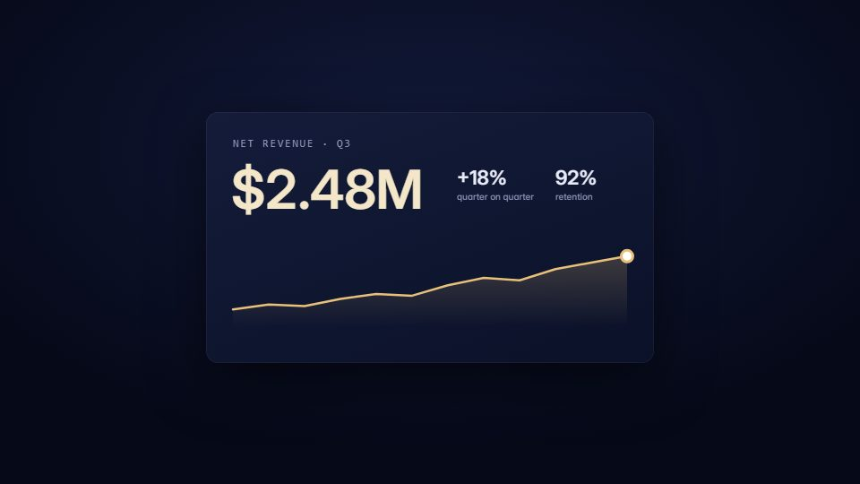

# Restrained premium product film

**Dark, precise, expensive-looking product reveal with the real UI as hero and almost no copy** · Fit for our films: **Ready: our kit builds it today** · Live demo: [`demos/demo.html#premium-product`](../demos/demo.html#premium-product)

## The look
Deep navy or graphite, one precious accent used sparingly (a gold or a single brand colour), crisp real UI, a monospace face for numbers, soft rim light, faint bloom, gentle vignette, grain only if it helps.

## How it moves
One shot, one idea. Transitions are object-driven: a chart point becomes a card's corner, a number becomes the next screen's amount. Staggered arrivals, overshoot under about 2%, a camera that moves like a macro product shoot.

## Shape of a piece
A glint reveals part of the mark; the hero surface resolves (number, then chart, then support metrics); chaos-to-order transformation; a calmer beat where the rhythm slows; pull out, the UI folds into one object, the wordmark holds.

## Craft rules
About four ideas per 15 s, product by about 2 s, 3–4 words of copy per scene. Every key frame should work as a still ad.

## Ask for, before building
Brand tokens and wordmark, current real screens, the real positioning line, safe demo values.

## Where it fits
Flagship launch, investor or executive opener, website hero.

## Build it with our kit
camera with parallax, screencast rebuilt in layers, light sweeps, shader grain and mesh gradient, the glide ease.

**Small helpers it would want (none built yet; the engine is unchanged):** A specular sweep across a UI card; a shared-element handoff registry (record the exact pixel box an object lands on, so both scenes use it).

## Tuning scale
| Energy | Pace | Camera | Density | Background | Type | Realism | Sound |
|---|---|---|---|---|---|---|---|
| −1 | −1 | +1 | −2 | −1 | −1 | +1 | −1 |

## Our director prompt
Direct this film (or these segments) in the **Restrained premium product film** style. Follow the script word for word, time everything to the voiceover clock, and show me the storyboard before building.

- **Look:** deep navy or graphite, one precious accent used sparingly (a gold or a single brand colour), crisp real UI, a monospace face for numbers, soft rim light, faint bloom, gentle vignette, grain only if it helps.
- **Motion:** one shot, one idea. Transitions are object-driven: a chart point becomes a card's corner, a number becomes the next screen's amount. Staggered arrivals, overshoot under about 2%, a camera that moves like a macro product shoot.
- **Shape of the piece:** a glint reveals part of the mark; the hero surface resolves (number, then chart, then support metrics); chaos-to-order transformation; a calmer beat where the rhythm slows; pull out, the UI folds into one object, the wordmark holds.
- **Rules:** about four ideas per 15 s, product by about 2 s, 3–4 words of copy per scene. Every key frame should work as a still ad.
- **Ask me first for:** brand tokens and wordmark, current real screens, the real positioning line, safe demo values.
- **Tuning scale:** Energy −1, Pace −1, Camera +1, Density −2, Background −1, Type −1, Realism +1, Sound −1.
- **Build it with:** camera with parallax, screencast rebuilt in layers, light sweeps, shader grain and mesh gradient, the glide ease.. Keep to the engine's craft rules: one primary mover, scenes that open sparse and build, text that is readable before anything ornamental moves.
