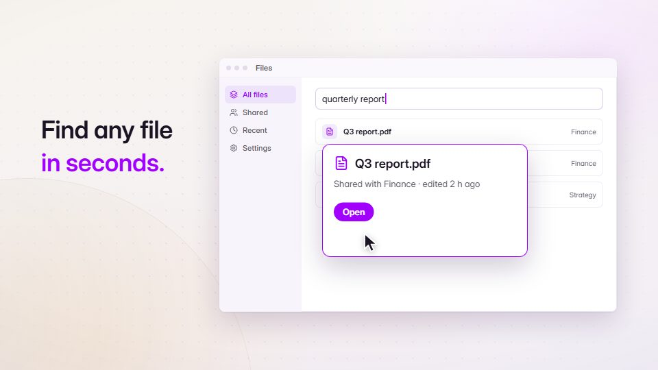

# Real-UI product promo

**The bulk: launch or promo videos built from a product's own site, repo, screenshots and brand tokens** · Fit for our films: **Ready: our kit builds it today** · Live demo: [`demos/demo.html#real-ui-promo`](../demos/demo.html#real-ui-promo)

## The look
Whatever the brand owns. The common thread is "use our real UI, not generic components": rebuilt screens, the real logo, the real palette.

## How it moves
Surfaces rise with a slight tilt that settles frontal, rows stagger in, a search types, a result expands into a hero card. Ideas last about a second, handoffs stay smooth, and one recurring element (player bar, sidebar, input) ties the shots.

## Shape of a piece
Problem hook, product appears, three proof moments (one feature each, shown not told), outcome line, wordmark and URL.

## Craft rules
Inspect the real product first; never invent features, customers or metrics (technique 13). It must work muted.

## Ask for, before building
URL or repo, screenshots, brand tokens, the three things it does, the claim guardrails (what not to say).

## Where it fits
Launch, feature release, ads, sales-deck video.

## Build it with our kit
screencast treatment, kinetic text, living ground, data pieces, music and SFX.

**Small helpers it would want (none built yet; the engine is unchanged):** A brand-token import (colours and fonts from a CSS or token file into our theme); a "recurring anchor" slot that persists across segments.

## Tuning scale
| Energy | Pace | Camera | Density | Background | Type | Realism | Sound |
|---|---|---|---|---|---|---|---|
| 0 | +1 | 0 | 0 | 0 | 0 | +1 | 0 |

## Our director prompt
Direct this film (or these segments) in the **Real-UI product promo** style. Follow the script word for word, time everything to the voiceover clock, and show me the storyboard before building.

- **Look:** whatever the brand owns. The common thread is "use our real UI, not generic components": rebuilt screens, the real logo, the real palette.
- **Motion:** surfaces rise with a slight tilt that settles frontal, rows stagger in, a search types, a result expands into a hero card. Ideas last about a second, handoffs stay smooth, and one recurring element (player bar, sidebar, input) ties the shots.
- **Shape of the piece:** problem hook, product appears, three proof moments (one feature each, shown not told), outcome line, wordmark and URL.
- **Rules:** inspect the real product first; never invent features, customers or metrics (technique 13). It must work muted.
- **Ask me first for:** URL or repo, screenshots, brand tokens, the three things it does, the claim guardrails (what not to say).
- **Tuning scale:** Energy 0, Pace +1, Camera 0, Density 0, Background 0, Type 0, Realism +1, Sound 0.
- **Build it with:** screencast treatment, kinetic text, living ground, data pieces, music and SFX.. Keep to the engine's craft rules: one primary mover, scenes that open sparse and build, text that is readable before anything ornamental moves.
