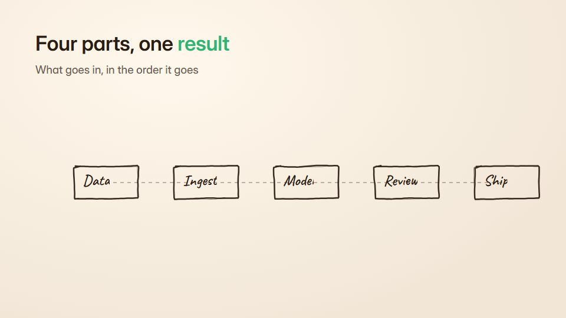

# Recipe-card step build

**A how-it's-made explainer that adds one ingredient at a time, with measures, live counters and a ticking checklist** · Fit for our films: **Ready: our kit builds it today** · Live demo: [`demos/demo.html#recipe-step-build`](../demos/demo.html#recipe-step-build)

## The look
Warm cream (#FFF6E9) with espresso ink (#2B1D14) and a fresh green (#2BB673); clean line icons per ingredient; a recipe card with a checklist on one side and the vessel or product in the middle.

## How it moves
Each ingredient drops in from above with its measure label, a level counter rises and the checklist ticks; a short pause after each step; the finished result turns slightly and a final touch lands.

## Shape of a piece
The empty vessel, 3-6 ingredients one by one, a mix or wait step, the finished result, the summary card.

## Craft rules
One ingredient per step, always with its amount; the checklist mirrors exactly what is shown.

## Ask for, before building
The ingredient or component list with amounts, the order, the finished result

## Where it fits
What-goes-into-our-product explainer, implementation recipe, onboarding checklist, solution bundle

## Build it with our kit
data counters and notes, hand-drawn ticks, kinetic text, living ground, music+SFX

**Small helpers it would want (none built yet; the engine is unchanged):** None

## Tuning scale
| Energy | Pace | Camera | Density | Background | Type | Realism | Sound |
|---|---|---|---|---|---|---|---|
| 0 | −1 | 0 | 0 | −1 | 0 | −1 | 0 |

## Our director prompt
Direct this film (or these segments) in the **Recipe-card step build** style. Follow the script word for word, time everything to the voiceover clock, and show me the storyboard before building.

- **Look:** Warm cream (#FFF6E9) with espresso ink (#2B1D14) and a fresh green (#2BB673); clean line icons per ingredient; a recipe card with a checklist on one side and the vessel or product in the middle.
- **Motion:** Each ingredient drops in from above with its measure label, a level counter rises and the checklist ticks; a short pause after each step; the finished result turns slightly and a final touch lands.
- **Shape of the piece:** The empty vessel, 3-6 ingredients one by one, a mix or wait step, the finished result, the summary card.
- **Rules:** One ingredient per step, always with its amount; the checklist mirrors exactly what is shown.
- **Ask me first for:** the ingredient or component list with amounts, the order, the finished result
- **Tuning scale:** Energy 0, Pace −1, Camera 0, Density 0, Background −1, Type 0, Realism −1, Sound 0.
- **Build it with:** data counters and notes, hand-drawn ticks, kinetic text, living ground, music+SFX. Keep to the engine's craft rules: one primary mover, scenes that open sparse and build, text that is readable before anything ornamental moves.
