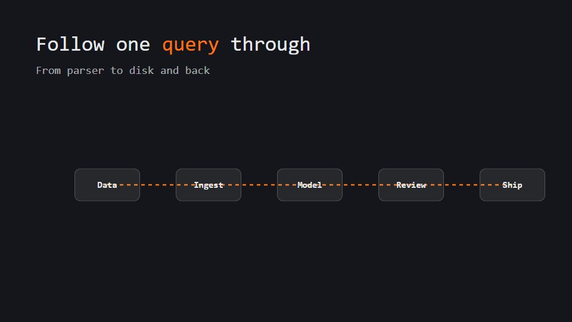

# Life-of-a-request trace

**A codebase or system shown as a map of modules, then one request travels through it step by step** · Fit for our films: **Ready: our kit builds it today** · Live demo: [`demos/demo.html#request-trace-codemap`](../demos/demo.html#request-trace-codemap)

## The look
Dark editor grey (#14161B) with module cards (#1F232B) labelled in mono; one bright token (#F97316) as the travelling request; thin muted-blue connectors (#3B4A6B) that light as the token passes.

## How it moves
Pull back to the whole map, then follow the token: each module it enters zooms up to show the key function or log line, and the camera rides the connector to the next. The pace slows at the important hop.

## Shape of a piece
What it does in one line, the code map, one request across 4-6 modules, the core abstractions named, a real trace replayed fast.

## Craft rules
Real module names and real code lines only; one token on one path, never two moving at once.

## Ask for, before building
The architecture list, the request path, 4-6 key snippets, a real trace

## Where it fits
Engineering onboarding, open-source repo explainer, architecture review, API explainer

## Build it with our kit
cards and strokes for the map, screencast code windows, camera travel and push-ins, data notes (mono)

**Small helpers it would want (none built yet; the engine is unchanged):** A path-follow helper that moves a token along connector curves

## Tuning scale
| Energy | Pace | Camera | Density | Background | Type | Realism | Sound |
|---|---|---|---|---|---|---|---|
| −1 | 0 | +1 | +1 | −1 | −1 | 0 | −1 |

## Our director prompt
Direct this film (or these segments) in the **Life-of-a-request trace** style. Follow the script word for word, time everything to the voiceover clock, and show me the storyboard before building.

- **Look:** Dark editor grey (#14161B) with module cards (#1F232B) labelled in mono; one bright token (#F97316) as the travelling request; thin muted-blue connectors (#3B4A6B) that light as the token passes.
- **Motion:** Pull back to the whole map, then follow the token: each module it enters zooms up to show the key function or log line, and the camera rides the connector to the next. The pace slows at the important hop.
- **Shape of the piece:** What it does in one line, the code map, one request across 4-6 modules, the core abstractions named, a real trace replayed fast.
- **Rules:** Real module names and real code lines only; one token on one path, never two moving at once.
- **Ask me first for:** the architecture list, the request path, 4-6 key snippets, a real trace
- **Tuning scale:** Energy −1, Pace 0, Camera +1, Density +1, Background −1, Type −1, Realism 0, Sound −1.
- **Build it with:** cards and strokes for the map, screencast code windows, camera travel and push-ins, data notes (mono). Keep to the engine's craft rules: one primary mover, scenes that open sparse and build, text that is readable before anything ornamental moves.
