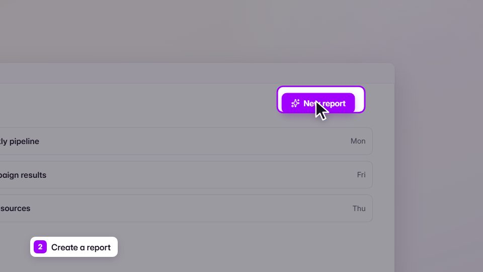

# Screen-guided walkthrough / how-to

**Cursor, clicks and tracking zooms through real screens; "5 features" or tutorial shorts** · Fit for our films: **Ready: our kit builds it today** · Live demo: [`demos/demo.html#screen-walkthrough`](../demos/demo.html#screen-walkthrough)

## The look
Real app windows on a calm ground, a slightly oversized cursor, a soft spotlight on the active region, step labels.

## How it moves
Screen-recorder-style zooms keyed on [time, zoom, x, y] in log space, a cursor that scales with the camera, click ripples, natural typing rhythm. Pushes last 1.5–3 s on gentle curves, about half the default speed.

## Shape of a piece
Title, then per step: zoom to region, act, result, short caption. Recap list with ticks drawing on.

## Craft rules
Cursor grammar (technique 16); every action shows a visible result; captions short and verbatim.

## Ask for, before building
Ordered screenshots or recordings, the step script, which region matters in each step.

## Where it fits
Onboarding, knowledge-transfer videos, release notes, support how-tos.

## Build it with our kit
screencast treatment, camera, kinetic captions. Our walkthrough film already proves it.

**Small helpers it would want (none built yet; the engine is unchanged):** A dim-and-spotlight mask; a cursor path solver (lead the target, speed cap, settle).

## Tuning scale
| Energy | Pace | Camera | Density | Background | Type | Realism | Sound |
|---|---|---|---|---|---|---|---|
| −1 | −1 | +1 | −1 | −1 | −1 | +2 | −1 |

## Our director prompt
Direct this film (or these segments) in the **Screen-guided walkthrough / how-to** style. Follow the script word for word, time everything to the voiceover clock, and show me the storyboard before building.

- **Look:** real app windows on a calm ground, a slightly oversized cursor, a soft spotlight on the active region, step labels.
- **Motion:** screen-recorder-style zooms keyed on [time, zoom, x, y] in log space, a cursor that scales with the camera, click ripples, natural typing rhythm. Pushes last 1.5–3 s on gentle curves, about half the default speed.
- **Shape of the piece:** title, then per step: zoom to region, act, result, short caption. Recap list with ticks drawing on.
- **Rules:** cursor grammar (technique 16); every action shows a visible result; captions short and verbatim.
- **Ask me first for:** ordered screenshots or recordings, the step script, which region matters in each step.
- **Tuning scale:** Energy −1, Pace −1, Camera +1, Density −1, Background −1, Type −1, Realism +2, Sound −1.
- **Build it with:** screencast treatment, camera, kinetic captions. Our walkthrough film already proves it.. Keep to the engine's craft rules: one primary mover, scenes that open sparse and build, text that is readable before anything ornamental moves.
