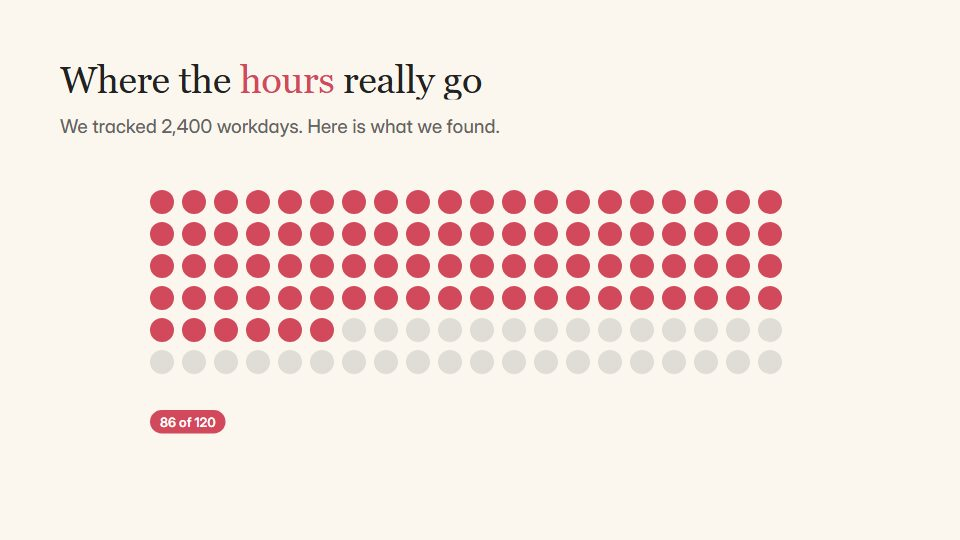

# Scrolling data essay

**A long-read data essay: a pinned chart holds while short annotated text cards scroll past and change it** · Fit for our films: **Ready: our kit builds it today** · Live demo: [`demos/demo.html#scrollytelling-essay`](../demos/demo.html#scrollytelling-essay)

## The look
Cream (#FBF7EF) with ink (#222222) and three muted data colours (#D1495B, #00798C, #EDAE49); a readable serif for text cards, a grotesque for labels; wide margins and thin rules.

## How it moves
The frame scrolls upward at reading speed; the chart stays pinned while cards pass, and each card triggers one change (highlight, filter, re-sort). Continuous, no cuts.

## Shape of a piece
Headline and standfirst, the chart pins, 4-6 cards each changing it, the chart releases into a conclusion, the sources line.

## Craft rules
One change per card, and the chart never changes without a card explaining why. Sources stay on screen.

## Ask for, before building
The dataset, 4-6 findings in order, sources, the closing insight

## Where it fits
Research report launch, market study, impact report, analyst briefing

## Build it with our kit
data units, bars and notes, kinetic text, camera travel (vertical), living ground

**Small helpers it would want (none built yet; the engine is unchanged):** A pin-and-scroll helper (one layer pinned while another travels)

## Tuning scale
| Energy | Pace | Camera | Density | Background | Type | Realism | Sound |
|---|---|---|---|---|---|---|---|
| −1 | −1 | +1 | +1 | −1 | 0 | 0 | −1 |

## Our director prompt
Direct this film (or these segments) in the **Scrolling data essay** style. Follow the script word for word, time everything to the voiceover clock, and show me the storyboard before building.

- **Look:** Cream (#FBF7EF) with ink (#222222) and three muted data colours (#D1495B, #00798C, #EDAE49); a readable serif for text cards, a grotesque for labels; wide margins and thin rules.
- **Motion:** The frame scrolls upward at reading speed; the chart stays pinned while cards pass, and each card triggers one change (highlight, filter, re-sort). Continuous, no cuts.
- **Shape of the piece:** Headline and standfirst, the chart pins, 4-6 cards each changing it, the chart releases into a conclusion, the sources line.
- **Rules:** One change per card, and the chart never changes without a card explaining why. Sources stay on screen.
- **Ask me first for:** the dataset, 4-6 findings in order, sources, the closing insight
- **Tuning scale:** Energy −1, Pace −1, Camera +1, Density +1, Background −1, Type 0, Realism 0, Sound −1.
- **Build it with:** data units, bars and notes, kinetic text, camera travel (vertical), living ground. Keep to the engine's craft rules: one primary mover, scenes that open sparse and build, text that is readable before anything ornamental moves.
