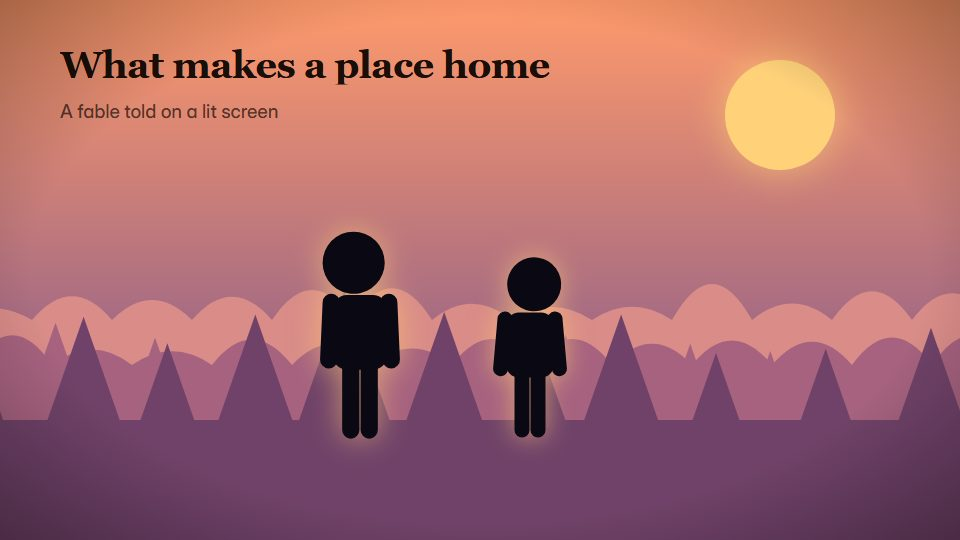

# Shadow-puppet theatre

**A fable played as shadow puppets on a lamp-lit screen, in black and translucent colour** · Fit for our films: **Adapt: needs a small helper or a stylisation** · Live demo: [`demos/demo.html#shadow-theatre-fable`](../demos/demo.html#shadow-theatre-fable)

## The look
A glowing screen in amber and saffron (#F6B04A to #E2732B, falling to #5A2412 at the edges) with black or translucent coloured silhouettes (#7A1F12, #2E5E4E); ornate cut-outs inside the shapes; lamp falloff as vignette; caption cards in a classic serif.

## How it moves
Puppets glide across on rods and turn by flipping; moving toward the screen sharpens them, moving back softens and enlarges them; the lamp flickers a little; scenes change with a cloth wipe.

## Shape of a piece
The lamp lights the screen, the cast enters, the problem, the clever turn, the moral as a caption, the lamp dims.

## Craft rules
Silhouettes must read from shape alone, with detail only in cut-outs. The moral is the script's own line.

## Ask for, before building
The fable beats, the moral line, the cast, palette

## Where it fits
Values or culture fable, CSR story, company origin myth, keynote interlude

## Build it with our kit
living ground washes and vignette, camera (mostly locked), kinetic text, shader grain, music+SFX

**Small helpers it would want (none built yet; the engine is unchanged):** A silhouette puppet with rod motion; blur by distance from the screen

## Tuning scale
| Energy | Pace | Camera | Density | Background | Type | Realism | Sound |
|---|---|---|---|---|---|---|---|
| −1 | −1 | −1 | −1 | +1 | −1 | −2 | 0 |

## Our director prompt
Direct this film (or these segments) in the **Shadow-puppet theatre** style. Follow the script word for word, time everything to the voiceover clock, and show me the storyboard before building.

- **Look:** A glowing screen in amber and saffron (#F6B04A to #E2732B, falling to #5A2412 at the edges) with black or translucent coloured silhouettes (#7A1F12, #2E5E4E); ornate cut-outs inside the shapes; lamp falloff as vignette; caption cards in a classic serif.
- **Motion:** Puppets glide across on rods and turn by flipping; moving toward the screen sharpens them, moving back softens and enlarges them; the lamp flickers a little; scenes change with a cloth wipe.
- **Shape of the piece:** The lamp lights the screen, the cast enters, the problem, the clever turn, the moral as a caption, the lamp dims.
- **Rules:** Silhouettes must read from shape alone, with detail only in cut-outs. The moral is the script's own line.
- **Ask me first for:** the fable beats, the moral line, the cast, palette
- **Tuning scale:** Energy −1, Pace −1, Camera −1, Density −1, Background +1, Type −1, Realism −2, Sound 0.
- **Build it with:** living ground washes and vignette, camera (mostly locked), kinetic text, shader grain, music+SFX. Keep to the engine's craft rules: one primary mover, scenes that open sparse and build, text that is readable before anything ornamental moves.
