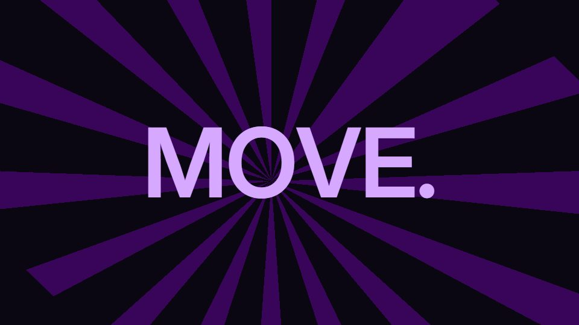

# Motion-designer showreel / sizzle

**"Show me what you can do": high-variety reel of techniques, usually 10–20 s** · Fit for our films: **Adapt: needs a small helper or a stylisation** · Live demo: [`demos/demo.html#showreel`](../demos/demo.html#showreel)

## The look
Usually too much (many styles in 15 s). The good ones push a single idea.

## How it moves
A beat on every quarter note, scene changes on downbeats, scale swings from close to wide to full-frame type, whips and smash-pans.

## Shape of a piece
Hook frame that is already finished, three to five "signature moments", a lockup.

## Craft rules
12–15 compositions per 30 s, each 1.4–3.5 s; never repeat a layout; name three signature moments without effect names.

## Ask for, before building
The single formal idea, the brand, the three moments.

## Where it fits
Agency or team sizzle, event opener, a brand-energy 10 s cut. Tame it with our "never too much" rule.

## Build it with our kit
everything, which is the risk; the tuning scale restrains it.

**Small helpers it would want (none built yet; the engine is unchanged):** A beat-grid scheduler that snaps cues to a grid (with an early-start offset); a per-film ban list checked at board time.

## Tuning scale
| Energy | Pace | Camera | Density | Background | Type | Realism | Sound |
|---|---|---|---|---|---|---|---|
| +2 | +2 | +1 | +1 | +1 | +1 | −1 | +2 |

## Our director prompt
Direct this film (or these segments) in the **Motion-designer showreel / sizzle** style. Follow the script word for word, time everything to the voiceover clock, and show me the storyboard before building.

- **Look:** usually too much (many styles in 15 s). The good ones push a single idea.
- **Motion:** a beat on every quarter note, scene changes on downbeats, scale swings from close to wide to full-frame type, whips and smash-pans.
- **Shape of the piece:** hook frame that is already finished, three to five "signature moments", a lockup.
- **Rules:** 12–15 compositions per 30 s, each 1.4–3.5 s; never repeat a layout; name three signature moments without effect names.
- **Ask me first for:** the single formal idea, the brand, the three moments.
- **Tuning scale:** Energy +2, Pace +2, Camera +1, Density +1, Background +1, Type +1, Realism −1, Sound +2.
- **Build it with:** everything, which is the risk; the tuning scale restrains it.. Keep to the engine's craft rules: one primary mover, scenes that open sparse and build, text that is readable before anything ornamental moves.
