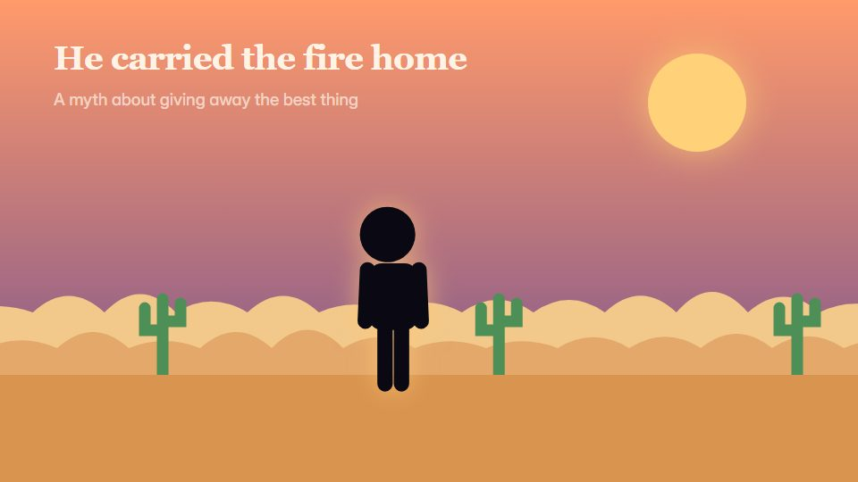

# Silhouette fable

**Black silhouettes against huge gradient skies, with one bright symbol carrying the plot and sound telling half the story** · Fit for our films: **Adapt: needs a small helper or a stylisation** · Live demo: [`demos/demo.html#silhouette-fable`](../demos/demo.html#silhouette-fable)

## The look
Pure black silhouettes (#0B0B0F) against big gradient skies (#1B1640 to #6A3D8F to #FF9A5A); a large sun or moon disc; no inner detail; sparse warm-white serif captions; one bright symbol colour (#FFD36B).

## How it moves
Silhouettes move slowly along the horizon; the sky shifts through the day as the story passes; one bright element (fire, lantern, bird) travels and carries the plot; sound does half the telling.

## Shape of a piece
The empty horizon, the hero appears, the gift or the loss, the long night, the light returns.

## Craft rules
Silhouettes only, so poses must read from outline; captions are rare and short, and silence is allowed to work.

## Ask for, before building
The fable beats, the bright symbol, caption lines, sound cues

## Where it fits
Mission or purpose film, values keynote opener, origin-myth brand story

## Build it with our kit
living ground washes (sky), camera travel, kinetic text, music+SFX

**Small helpers it would want (none built yet; the engine is unchanged):** A silhouette puppet rig

## Tuning scale
| Energy | Pace | Camera | Density | Background | Type | Realism | Sound |
|---|---|---|---|---|---|---|---|
| −1 | −1 | 0 | −2 | +2 | −1 | −2 | +1 |

## Our director prompt
Direct this film (or these segments) in the **Silhouette fable** style. Follow the script word for word, time everything to the voiceover clock, and show me the storyboard before building.

- **Look:** Pure black silhouettes (#0B0B0F) against big gradient skies (#1B1640 to #6A3D8F to #FF9A5A); a large sun or moon disc; no inner detail; sparse warm-white serif captions; one bright symbol colour (#FFD36B).
- **Motion:** Silhouettes move slowly along the horizon; the sky shifts through the day as the story passes; one bright element (fire, lantern, bird) travels and carries the plot; sound does half the telling.
- **Shape of the piece:** The empty horizon, the hero appears, the gift or the loss, the long night, the light returns.
- **Rules:** Silhouettes only, so poses must read from outline; captions are rare and short, and silence is allowed to work.
- **Ask me first for:** the fable beats, the bright symbol, caption lines, sound cues
- **Tuning scale:** Energy −1, Pace −1, Camera 0, Density −2, Background +2, Type −1, Realism −2, Sound +1.
- **Build it with:** living ground washes (sky), camera travel, kinetic text, music+SFX. Keep to the engine's craft rules: one primary mover, scenes that open sparse and build, text that is readable before anything ornamental moves.
