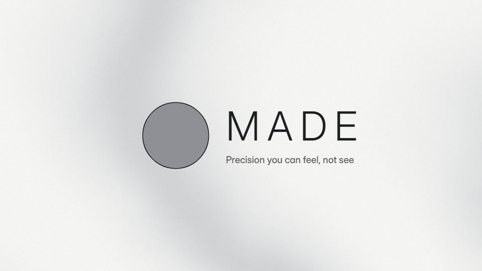

# Silver monochrome reveal

**A colourless light-studio reveal in silver, white and soft shadow, with no accent at all** · Fit for our films: **Ready: our kit builds it today** · Live demo: [`demos/demo.html#silver-studio-reveal`](../demos/demo.html#silver-studio-reveal)

## The look
Pale studio greys (#F2F2F0 to #D9DADC) on a slow silk sweep; charcoal (#1D1E20) type in a light grotesque with wide tracking; hairline dividers; the object sits in a soft contact shadow.

## How it moves
Very slow pushes and one specular glint travelling across the hero; type arrives by its letter-spacing closing up rather than by moving. Long holds, few cuts.

## Shape of a piece
A glint crosses a surface, the object resolves, two quiet claims, the wordmark in thin type.

## Craft rules
No colour except the product's own; contrast comes only from light and shadow, and the glint is the single flourish.

## Ask for, before building
Clean product photos or screens on neutral, the wordmark, one positioning line

## Where it fits
Hardware or device launch, brand refresh, premium executive film

## Build it with our kit
shader silk ground, real photos, kinetic text blur entrance, living ground sweeps, camera push

**Small helpers it would want (none built yet; the engine is unchanged):** A specular glint pass over an image or card

## Tuning scale
| Energy | Pace | Camera | Density | Background | Type | Realism | Sound |
|---|---|---|---|---|---|---|---|
| −2 | −2 | 0 | −2 | −1 | −1 | +1 | −2 |

## Our director prompt
Direct this film (or these segments) in the **Silver monochrome reveal** style. Follow the script word for word, time everything to the voiceover clock, and show me the storyboard before building.

- **Look:** Pale studio greys (#F2F2F0 to #D9DADC) on a slow silk sweep; charcoal (#1D1E20) type in a light grotesque with wide tracking; hairline dividers; the object sits in a soft contact shadow.
- **Motion:** Very slow pushes and one specular glint travelling across the hero; type arrives by its letter-spacing closing up rather than by moving. Long holds, few cuts.
- **Shape of the piece:** A glint crosses a surface, the object resolves, two quiet claims, the wordmark in thin type.
- **Rules:** No colour except the product's own; contrast comes only from light and shadow, and the glint is the single flourish.
- **Ask me first for:** clean product photos or screens on neutral, the wordmark, one positioning line
- **Tuning scale:** Energy −2, Pace −2, Camera 0, Density −2, Background −1, Type −1, Realism +1, Sound −2.
- **Build it with:** shader silk ground, real photos, kinetic text blur entrance, living ground sweeps, camera push. Keep to the engine's craft rules: one primary mover, scenes that open sparse and build, text that is readable before anything ornamental moves.
