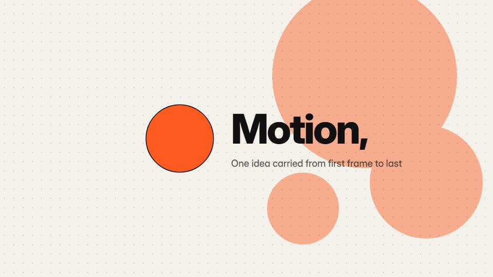

# Single-dot studio reel

**One coloured dot is the through-line: it starts in the UI, sits over a letter, traces a curve and closes the film** · Fit for our films: **Ready: our kit builds it today** · Live demo: [`demos/demo.html#single-dot-throughline`](../demos/demo.html#single-dot-throughline)

## The look
Warm off-white (#F4F1EA) and near-black (#111111) with one vivid orange dot (#FF5A1F); bold grotesque type; dotted connectors, a fine dot grid and a ring of orbiting words.

## How it moves
The dot carries every cut: it races along a line, swells to fill the frame, shrinks to a point on black and comes back. Springs with a tiny overshoot; no glow, gradient or particles.

## Shape of a piece
A click on a small control, a word forms with the dot above one letter, the dot draws a curve, words circle it, a dot field flips to the end card.

## Craft rules
Orange appears only as the dot or as something the dot turned into; every transition grows from an element already on screen.

## Ask for, before building
The hero word, one UI moment, one metric for the curve, end-card lines, accent colour

## Where it fits
Brand signature film, studio or team intro, short launch teaser

## Build it with our kit
continuity moves, kinetic text letter-by-letter, data line, living ground dots, cursor, music+SFX

**Small helpers it would want (none built yet; the engine is unchanged):** Text laid out on a circle for the orbiting words

## Tuning scale
| Energy | Pace | Camera | Density | Background | Type | Realism | Sound |
|---|---|---|---|---|---|---|---|
| +1 | +1 | 0 | −1 | −1 | +1 | −1 | +1 |

## Our director prompt
Direct this film (or these segments) in the **Single-dot studio reel** style. Follow the script word for word, time everything to the voiceover clock, and show me the storyboard before building.

- **Look:** Warm off-white (#F4F1EA) and near-black (#111111) with one vivid orange dot (#FF5A1F); bold grotesque type; dotted connectors, a fine dot grid and a ring of orbiting words.
- **Motion:** The dot carries every cut: it races along a line, swells to fill the frame, shrinks to a point on black and comes back. Springs with a tiny overshoot; no glow, gradient or particles.
- **Shape of the piece:** A click on a small control, a word forms with the dot above one letter, the dot draws a curve, words circle it, a dot field flips to the end card.
- **Rules:** Orange appears only as the dot or as something the dot turned into; every transition grows from an element already on screen.
- **Ask me first for:** the hero word, one UI moment, one metric for the curve, end-card lines, accent colour
- **Tuning scale:** Energy +1, Pace +1, Camera 0, Density −1, Background −1, Type +1, Realism −1, Sound +1.
- **Build it with:** continuity moves, kinetic text letter-by-letter, data line, living ground dots, cursor, music+SFX. Keep to the engine's craft rules: one primary mover, scenes that open sparse and build, text that is readable before anything ornamental moves.
