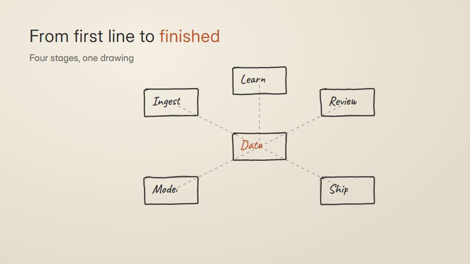

# Sketch-to-render progression

**A subject grows in four stages: first pencil lines, then grey massing, then detail, then the finished full-colour result** · Fit for our films: **Adapt: needs a small helper or a stylisation** · Live demo: [`demos/demo.html#sketch-to-render`](../demos/demo.html#sketch-to-render)

## The look
Graphite on warm paper (#EFE9DD, #2E2E2E) at the start, flat grey massing (#B8B4AC) in the middle, finished colour or a real photo at the end, with one warm accent (#C2562F); hatching for shadow; a light technical sans for stage labels.

## How it moves
Each stage builds over the last in place: lines draw, volumes fill, details ink in, then the photo or render wipes through the drawing from one edge. The camera pushes or orbits slowly while stage labels tick 1 to 4.

## Shape of a piece
First lines, massing, detail, finished, then a pull back to context.

## Craft rules
Each stage keeps the previous stage's geometry exactly; scale never jumps between stages.

## Ask for, before building
The final image or render, the subject's outline or plan, stage labels

## Where it fits
Architecture or property, product design story, idea-to-launch roadmap, construction progress

## Build it with our kit
hand-drawn strokes, real photos, continuity moves (edge wipe), camera push, living ground (paper)

**Small helpers it would want (none built yet; the engine is unchanged):** A hatching fill; an edge wipe from drawing to photo

## Tuning scale
| Energy | Pace | Camera | Density | Background | Type | Realism | Sound |
|---|---|---|---|---|---|---|---|
| −1 | −1 | +1 | 0 | 0 | −1 | +1 | −1 |

## Our director prompt
Direct this film (or these segments) in the **Sketch-to-render progression** style. Follow the script word for word, time everything to the voiceover clock, and show me the storyboard before building.

- **Look:** Graphite on warm paper (#EFE9DD, #2E2E2E) at the start, flat grey massing (#B8B4AC) in the middle, finished colour or a real photo at the end, with one warm accent (#C2562F); hatching for shadow; a light technical sans for stage labels.
- **Motion:** Each stage builds over the last in place: lines draw, volumes fill, details ink in, then the photo or render wipes through the drawing from one edge. The camera pushes or orbits slowly while stage labels tick 1 to 4.
- **Shape of the piece:** First lines, massing, detail, finished, then a pull back to context.
- **Rules:** Each stage keeps the previous stage's geometry exactly; scale never jumps between stages.
- **Ask me first for:** the final image or render, the subject's outline or plan, stage labels
- **Tuning scale:** Energy −1, Pace −1, Camera +1, Density 0, Background 0, Type −1, Realism +1, Sound −1.
- **Build it with:** hand-drawn strokes, real photos, continuity moves (edge wipe), camera push, living ground (paper). Keep to the engine's craft rules: one primary mover, scenes that open sparse and build, text that is readable before anything ornamental moves.
