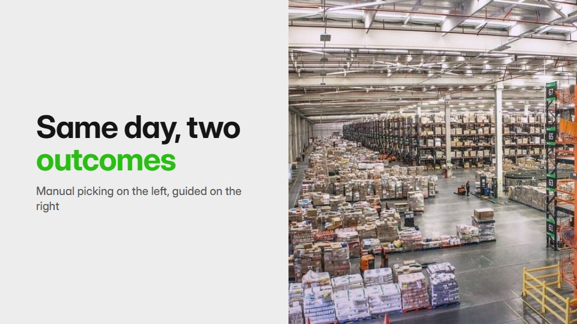

# Synchronised split compare

**Two or three versions play side by side in lockstep (old and new, healthy and broken) so the difference explains itself** · Fit for our films: **Ready: our kit builds it today** · Live demo: [`demos/demo.html#split-compare`](../demos/demo.html#split-compare)

## The look
Neutral grey (#EDEDED) split by a crisp white gutter; each side tinted by its state (#E4572E for the failing side, #29BF12 for the fixed one); identical layouts and labels in a clear grotesque.

## How it moves
Both halves run one timeline so differences appear at the same instant; the divider slides to favour one side; a slider or toggle moves the state from intact to broken.

## Shape of a piece
Set up both sides identically, start the same event, watch them diverge, the slider sweeps between them, the verdict.

## Craft rules
Same framing and timing on every side, with only one variable changing; labels sit in matching places.

## Ask for, before building
The two or three states, the event that shows the difference, the measured outcome

## Where it fits
Before/after value proof, old-way vs new-way story, medical or process explainer, ROI story

## Build it with our kit
real photos or screencast, data line and counters, continuity moves, kinetic text, camera (locked)

**Small helpers it would want (none built yet; the engine is unchanged):** A split-view compositor with a sliding divider

## Tuning scale
| Energy | Pace | Camera | Density | Background | Type | Realism | Sound |
|---|---|---|---|---|---|---|---|
| 0 | 0 | −1 | 0 | −1 | 0 | +1 | 0 |

## Our director prompt
Direct this film (or these segments) in the **Synchronised split compare** style. Follow the script word for word, time everything to the voiceover clock, and show me the storyboard before building.

- **Look:** Neutral grey (#EDEDED) split by a crisp white gutter; each side tinted by its state (#E4572E for the failing side, #29BF12 for the fixed one); identical layouts and labels in a clear grotesque.
- **Motion:** Both halves run one timeline so differences appear at the same instant; the divider slides to favour one side; a slider or toggle moves the state from intact to broken.
- **Shape of the piece:** Set up both sides identically, start the same event, watch them diverge, the slider sweeps between them, the verdict.
- **Rules:** Same framing and timing on every side, with only one variable changing; labels sit in matching places.
- **Ask me first for:** the two or three states, the event that shows the difference, the measured outcome
- **Tuning scale:** Energy 0, Pace 0, Camera −1, Density 0, Background −1, Type 0, Realism +1, Sound 0.
- **Build it with:** real photos or screencast, data line and counters, continuity moves, kinetic text, camera (locked). Keep to the engine's craft rules: one primary mover, scenes that open sparse and build, text that is readable before anything ornamental moves.
