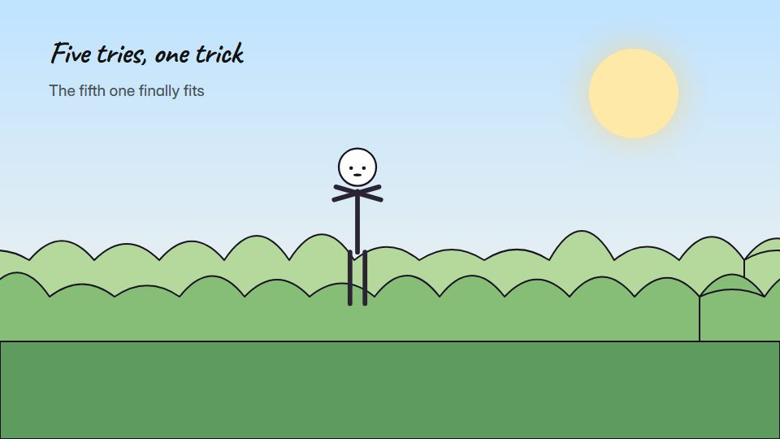

# Stick-figure explainer story

**Quick marker stick figures act out a small story on a white board, with red kept for the one point to remember** · Fit for our films: **Adapt: needs a small helper or a stylisation** · Live demo: [`demos/demo.html#stick-figure-story`](../demos/demo.html#stick-figure-story)

## The look
White board (#FFFFFF) with black marker stick figures (#111111) and one red (#E63946) for the key point; quick hand lettering; simple props drawn as needed; a count scribbled in a corner.

## How it moves
Figures draw on in a few strokes, then animate with snappy poses; props appear by being drawn; the hand-lettered count climbs; the camera mostly holds and pans as the board fills.

## Shape of a piece
The stick hero and their task, try one, try two, the trick, the payoff circled in red.

## Craft rules
Drawing speed beats detail; red only on the point to remember; the board never fills up.

## Ask for, before building
Script, the task and the trick, the key point, any counts

## Where it fits
Process explainer, tip or how-to, training story, sales objection story

## Build it with our kit
hand-drawn strokes and handwriting, data counters (hand), camera pan, music+SFX

**Small helpers it would want (none built yet; the engine is unchanged):** A stick-figure pose set with stroke draw-on

## Tuning scale
| Energy | Pace | Camera | Density | Background | Type | Realism | Sound |
|---|---|---|---|---|---|---|---|
| 0 | +1 | 0 | −1 | −2 | −1 | −2 | 0 |

## Our director prompt
Direct this film (or these segments) in the **Stick-figure explainer story** style. Follow the script word for word, time everything to the voiceover clock, and show me the storyboard before building.

- **Look:** White board (#FFFFFF) with black marker stick figures (#111111) and one red (#E63946) for the key point; quick hand lettering; simple props drawn as needed; a count scribbled in a corner.
- **Motion:** Figures draw on in a few strokes, then animate with snappy poses; props appear by being drawn; the hand-lettered count climbs; the camera mostly holds and pans as the board fills.
- **Shape of the piece:** The stick hero and their task, try one, try two, the trick, the payoff circled in red.
- **Rules:** Drawing speed beats detail; red only on the point to remember; the board never fills up.
- **Ask me first for:** script, the task and the trick, the key point, any counts
- **Tuning scale:** Energy 0, Pace +1, Camera 0, Density −1, Background −2, Type −1, Realism −2, Sound 0.
- **Build it with:** hand-drawn strokes and handwriting, data counters (hand), camera pan, music+SFX. Keep to the engine's craft rules: one primary mover, scenes that open sparse and build, text that is readable before anything ornamental moves.
