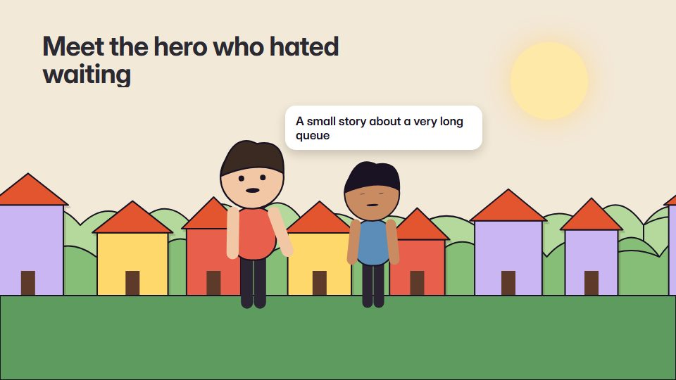

# Character story world

**A small cast of simple 2D characters in a world built in code, staged like an animated short and timed to the voiceover** · Fit for our films: **Adapt: needs a small helper or a stylisation** · Live demo: [`demos/demo.html#story-world`](../demos/demo.html#story-world)

## The look
One coherent world per film: a limited palette (here warm paper #F3E9D8, ink #2B2A33, hero colour #E8604C, support blue #5B8DB8), characters built from simple shapes with fixed proportions, three depth layers (far, mid, near) and the hero colour kept for the protagonist.

## How it moves
Characters run simple cycles (walk, wave, talk, look) with small squash and stretch; the camera pans and parallaxes through the layers like a stage; scenes change through the world itself (time of day, a door, a pan), never through slides.

## Shape of a piece
Meet the hero in their world, the problem arrives, the hero tries, the helper (the product) appears, the change, the hero's world at rest.

## Craft rules
One protagonist with one clear want, and every shot acts out its script line. Fictional characters only; no parody of real people.

## Ask for, before building
The script, the protagonist and their want, the world (office, city, nature), brand palette, who or what the helper is

## Where it fits
Brand origin story, customer story with a protagonist, values or culture fable, onboarding story, impact report

## Build it with our kit
camera with parallax, living ground washes, hand-drawn strokes, kinetic text, continuity moves, music+SFX

**Small helpers it would want (none built yet; the engine is unchanged):** A 2D puppet rig (jointed parts with pivots and walk, wave, talk and look cycles); a layered set builder (far, mid, near)

## Tuning scale
| Energy | Pace | Camera | Density | Background | Type | Realism | Sound |
|---|---|---|---|---|---|---|---|
| 0 | −1 | +1 | 0 | +1 | −1 | −1 | 0 |

## Our director prompt
Direct this film (or these segments) in the **Character story world** style. Follow the script word for word, time everything to the voiceover clock, and show me the storyboard before building.

- **Look:** One coherent world per film: a limited palette (here warm paper #F3E9D8, ink #2B2A33, hero colour #E8604C, support blue #5B8DB8), characters built from simple shapes with fixed proportions, three depth layers (far, mid, near) and the hero colour kept for the protagonist.
- **Motion:** Characters run simple cycles (walk, wave, talk, look) with small squash and stretch; the camera pans and parallaxes through the layers like a stage; scenes change through the world itself (time of day, a door, a pan), never through slides.
- **Shape of the piece:** Meet the hero in their world, the problem arrives, the hero tries, the helper (the product) appears, the change, the hero's world at rest.
- **Rules:** One protagonist with one clear want, and every shot acts out its script line. Fictional characters only; no parody of real people.
- **Ask me first for:** the script, the protagonist and their want, the world (office, city, nature), brand palette, who or what the helper is
- **Tuning scale:** Energy 0, Pace −1, Camera +1, Density 0, Background +1, Type −1, Realism −1, Sound 0.
- **Build it with:** camera with parallax, living ground washes, hand-drawn strokes, kinetic text, continuity moves, music+SFX. Keep to the engine's craft rules: one primary mover, scenes that open sparse and build, text that is readable before anything ornamental moves.
