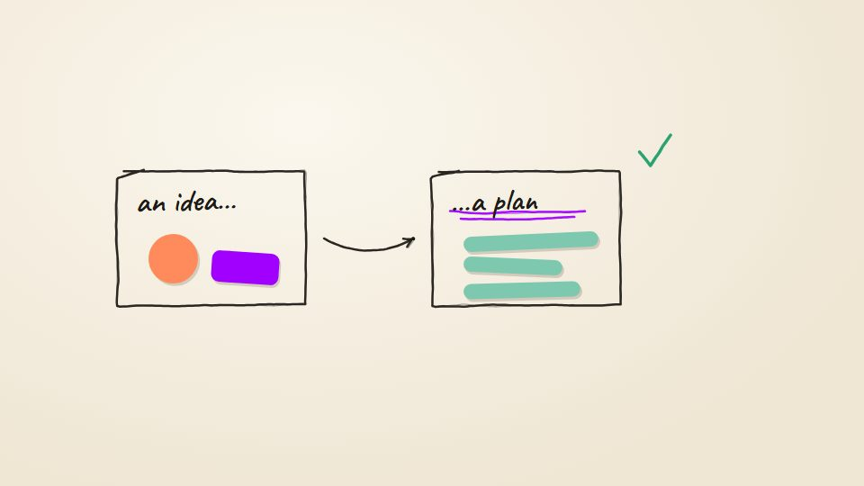

# Storybook, hand-drawn and paper collage

**Paper grain, crayon, doodles, cut paper, whiteboard; whimsical explainers** · Fit for our films: **Ready: our kit builds it today** · Live demo: [`demos/demo.html#storybook`](../demos/demo.html#storybook)

## The look
Off-white paper with grain and tooth, crayon or pencil lines that wobble slightly, cut-paper shapes with soft drop shadows, one or two inks, typewriter-tape labels, a warm vignette.

## How it moves
Lines boil (re-seeded jitter several times a second). Motion is quantised "on twos" for a handmade feel even at 60 fps. Paper pieces slide and land with tiny settles. Onomatopoeia and callbacks hold attention.

## Shape of a piece
Character or object intro, problem, journey with two or three gags, insight, a callback ending.

## Craft rules
Write a style bible and component kit first, so every scene is the same show. Keep texture cheap.

## Ask for, before building
The script, tone, any brand palette, whether people appear (use real photos for people).

## Where it fits
Friendly explainers, HR and onboarding, customer education.

## Build it with our kit
hand-drawn line treatment (rough strokes, arrows, handwriting), grain shader, real photos as cut-outs.

**Small helpers it would want (none built yet; the engine is unchanged):** A "on twos" time quantiser; a line boil; a cut-paper shadow style.

## Tuning scale
| Energy | Pace | Camera | Density | Background | Type | Realism | Sound |
|---|---|---|---|---|---|---|---|
| 0 | 0 | −1 | 0 | 0 | 0 | −2 | 0 |

## Our director prompt
Direct this film (or these segments) in the **Storybook, hand-drawn and paper collage** style. Follow the script word for word, time everything to the voiceover clock, and show me the storyboard before building.

- **Look:** off-white paper with grain and tooth, crayon or pencil lines that wobble slightly, cut-paper shapes with soft drop shadows, one or two inks, typewriter-tape labels, a warm vignette.
- **Motion:** lines boil (re-seeded jitter several times a second). Motion is quantised "on twos" for a handmade feel even at 60 fps. Paper pieces slide and land with tiny settles. Onomatopoeia and callbacks hold attention.
- **Shape of the piece:** character or object intro, problem, journey with two or three gags, insight, a callback ending.
- **Rules:** write a style bible and component kit first, so every scene is the same show. Keep texture cheap.
- **Ask me first for:** the script, tone, any brand palette, whether people appear (use real photos for people).
- **Tuning scale:** Energy 0, Pace 0, Camera −1, Density 0, Background 0, Type 0, Realism −2, Sound 0.
- **Build it with:** hand-drawn line treatment (rough strokes, arrows, handwriting), grain shader, real photos as cut-outs.. Keep to the engine's craft rules: one primary mover, scenes that open sparse and build, text that is readable before anything ornamental moves.
