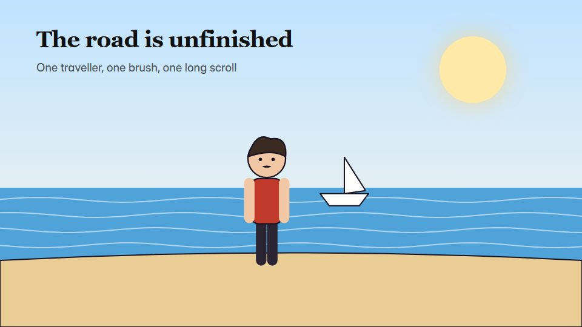

# Sumi-e ink epic

**A hero's journey painted live in black ink on rice paper, fast brushwork between long still holds** · Fit for our films: **Adapt: needs a small helper or a stylisation** · Live demo: [`demos/demo.html#sumi-ink-epic`](../demos/demo.html#sumi-ink-epic)

## The look
Rice paper (#F2EDE2) with black ink in all its greys (#111111 to #9A9A9A), splashes and dry-brush edges; one red seal or sun (#C0392B); characters as quick brush gestures; vertical brush captions.

## How it moves
Strokes paint themselves in the brush's direction, ink spreads and dries into place; action is fast and decisive between long stillnesses; the camera tracks sideways along one long scroll.

## Shape of a piece
Empty paper, a single stroke becomes the horizon, the journey in 3 painted beats, the decisive moment as a splash, the stillness after.

## Craft rules
White space is the main element: never fill more than half the paper, and use one red only.

## Ask for, before building
Script, the journey beats, the decisive moment, any brush keywords

## Where it fits
Leadership or resilience story, manifesto with a hero, strategy-journey film

## Build it with our kit
hand-drawn strokes (brush), living ground paper, camera travel, kinetic text, music+SFX

**Small helpers it would want (none built yet; the engine is unchanged):** A brush-stroke renderer with pressure and dry edges; an ink-spread mask

## Tuning scale
| Energy | Pace | Camera | Density | Background | Type | Realism | Sound |
|---|---|---|---|---|---|---|---|
| 0 | 0 | +1 | −2 | 0 | 0 | −2 | +1 |

## Our director prompt
Direct this film (or these segments) in the **Sumi-e ink epic** style. Follow the script word for word, time everything to the voiceover clock, and show me the storyboard before building.

- **Look:** Rice paper (#F2EDE2) with black ink in all its greys (#111111 to #9A9A9A), splashes and dry-brush edges; one red seal or sun (#C0392B); characters as quick brush gestures; vertical brush captions.
- **Motion:** Strokes paint themselves in the brush's direction, ink spreads and dries into place; action is fast and decisive between long stillnesses; the camera tracks sideways along one long scroll.
- **Shape of the piece:** Empty paper, a single stroke becomes the horizon, the journey in 3 painted beats, the decisive moment as a splash, the stillness after.
- **Rules:** White space is the main element: never fill more than half the paper, and use one red only.
- **Ask me first for:** script, the journey beats, the decisive moment, any brush keywords
- **Tuning scale:** Energy 0, Pace 0, Camera +1, Density −2, Background 0, Type 0, Realism −2, Sound +1.
- **Build it with:** hand-drawn strokes (brush), living ground paper, camera travel, kinetic text, music+SFX. Keep to the engine's craft rules: one primary mover, scenes that open sparse and build, text that is readable before anything ornamental moves.
