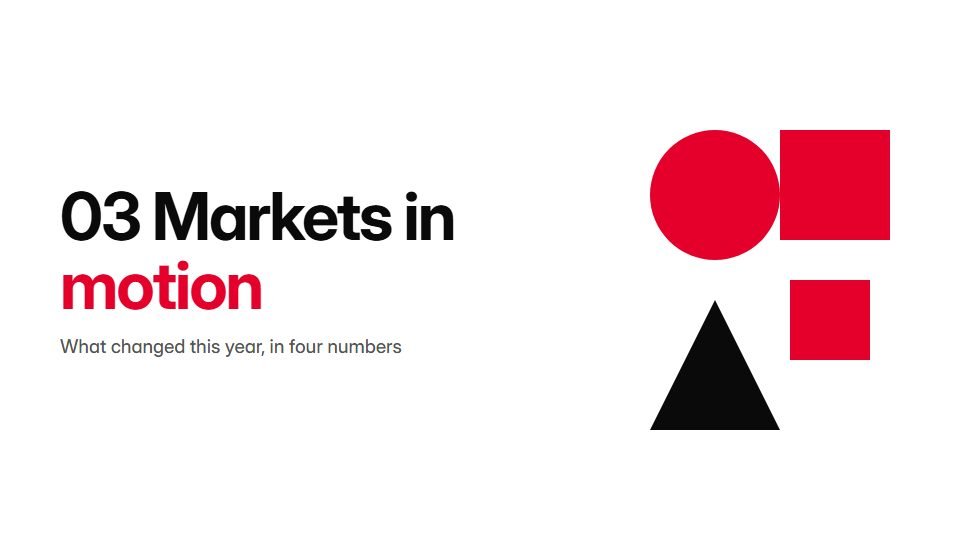

# Swiss grid editorial

**Strict modular grid, flush-left grotesque, red accents and huge numerals: information as layout** · Fit for our films: **Ready: our kit builds it today** · Live demo: [`demos/demo.html#swiss-grid-editorial`](../demos/demo.html#swiss-grid-editorial)

## The look
White (#FFFFFF) with black (#0A0A0A) and signal red (#E4002B); a neutral grotesque in two weights, flush left and ragged right; visible 12-column hairlines, large index numbers, small captions.

## How it moves
Blocks slide along grid lines and stop exactly on columns; text reveals by mask wipes tied to the baseline grid; a red bar sweeps to mark the current point. Precise and unhurried, no rotation.

## Shape of a piece
A grid draws, the title locks to it, three numbered sections each rearrange the grid, a summary table, the sign-off.

## Craft rules
Everything snaps to columns and baseline; asymmetry over centring; one red element per frame.

## Ask for, before building
The copy split into numbered points, key figures, photos to crop into grid cells

## Where it fits
Annual report film, strategy or research summary, consulting deck video, editorial brand piece

## Build it with our kit
kinetic text mask wipe, living ground grid, data bars and notes, real photos, camera (locked)

**Small helpers it would want (none built yet; the engine is unchanged):** A grid-snap layout helper (columns plus baseline)

## Tuning scale
| Energy | Pace | Camera | Density | Background | Type | Realism | Sound |
|---|---|---|---|---|---|---|---|
| −1 | 0 | −2 | +1 | −1 | +1 | −1 | −1 |

## Our director prompt
Direct this film (or these segments) in the **Swiss grid editorial** style. Follow the script word for word, time everything to the voiceover clock, and show me the storyboard before building.

- **Look:** White (#FFFFFF) with black (#0A0A0A) and signal red (#E4002B); a neutral grotesque in two weights, flush left and ragged right; visible 12-column hairlines, large index numbers, small captions.
- **Motion:** Blocks slide along grid lines and stop exactly on columns; text reveals by mask wipes tied to the baseline grid; a red bar sweeps to mark the current point. Precise and unhurried, no rotation.
- **Shape of the piece:** A grid draws, the title locks to it, three numbered sections each rearrange the grid, a summary table, the sign-off.
- **Rules:** Everything snaps to columns and baseline; asymmetry over centring; one red element per frame.
- **Ask me first for:** the copy split into numbered points, key figures, photos to crop into grid cells
- **Tuning scale:** Energy −1, Pace 0, Camera −2, Density +1, Background −1, Type +1, Realism −1, Sound −1.
- **Build it with:** kinetic text mask wipe, living ground grid, data bars and notes, real photos, camera (locked). Keep to the engine's craft rules: one primary mover, scenes that open sparse and build, text that is readable before anything ornamental moves.
