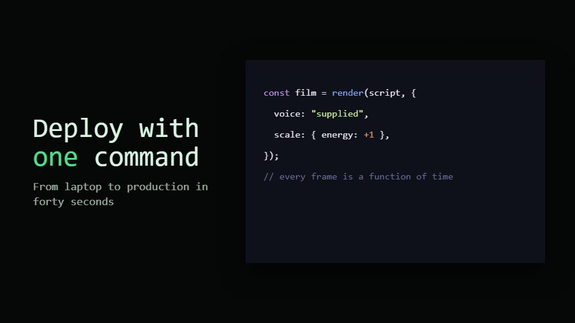

# Terminal-session launch

**The whole story plays out in a command-line session: typed commands, live logs and one result that lands** · Fit for our films: **Ready: our kit builds it today** · Live demo: [`demos/demo.html#terminal-session-launch`](../demos/demo.html#terminal-session-launch)

## The look
Near-black terminal (#0B0E0C) with phosphor green prompts (#4BE38A) and amber highlights (#FFB84D); monospace throughout, one sans only on the end card; thin window bar, block cursor, text spinners and progress bars.

## How it moves
Commands type with a human rhythm, output scrolls line by line, spinners tick, a success line flashes and the camera pushes into it. Scenes change by clearing the screen or splitting panes.

## Shape of a piece
Empty prompt, the run command, streaming output, one decisive result (tests pass, URL live), the name and the command to try.

## Craft rules
Real commands and believable output only; keep each burst of output short enough to read. One colour means success, one means attention.

## Ask for, before building
The real CLI commands and output, the result to celebrate, install line, brand mark

## Where it fits
CLI or developer-tool launch, release notes, open-source announcement, internal platform film

## Build it with our kit
screencast windows and typed inputs, kinetic text letter-by-letter, camera push-ins, music+SFX (keys)

**Small helpers it would want (none built yet; the engine is unchanged):** A terminal pane with streaming lines and spinners

## Tuning scale
| Energy | Pace | Camera | Density | Background | Type | Realism | Sound |
|---|---|---|---|---|---|---|---|
| 0 | 0 | 0 | 0 | −2 | 0 | +1 | 0 |

## Our director prompt
Direct this film (or these segments) in the **Terminal-session launch** style. Follow the script word for word, time everything to the voiceover clock, and show me the storyboard before building.

- **Look:** Near-black terminal (#0B0E0C) with phosphor green prompts (#4BE38A) and amber highlights (#FFB84D); monospace throughout, one sans only on the end card; thin window bar, block cursor, text spinners and progress bars.
- **Motion:** Commands type with a human rhythm, output scrolls line by line, spinners tick, a success line flashes and the camera pushes into it. Scenes change by clearing the screen or splitting panes.
- **Shape of the piece:** Empty prompt, the run command, streaming output, one decisive result (tests pass, URL live), the name and the command to try.
- **Rules:** Real commands and believable output only; keep each burst of output short enough to read. One colour means success, one means attention.
- **Ask me first for:** the real CLI commands and output, the result to celebrate, install line, brand mark
- **Tuning scale:** Energy 0, Pace 0, Camera 0, Density 0, Background −2, Type 0, Realism +1, Sound 0.
- **Build it with:** screencast windows and typed inputs, kinetic text letter-by-letter, camera push-ins, music+SFX (keys). Keep to the engine's craft rules: one primary mover, scenes that open sparse and build, text that is readable before anything ornamental moves.
