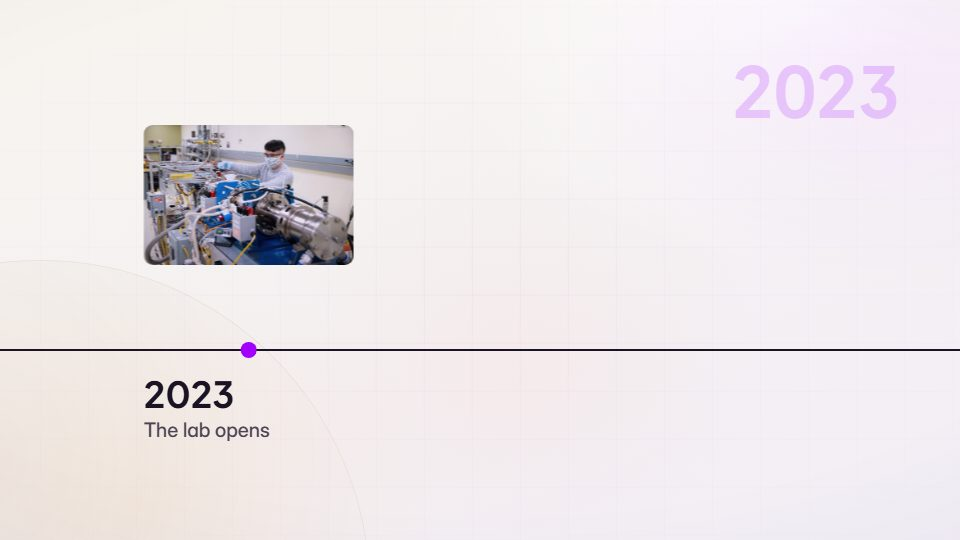

# Timeline / history chronicle

**Eras and years marching by: history of a field, company or life** · Fit for our films: **Ready: our kit builds it today** · Live demo: [`demos/demo.html#timeline`](../demos/demo.html#timeline)

## The look
A horizontal rail or stacked years, large year numerals, an era palette that shifts with time, archival photos where real people appear.

## How it moves
The camera travels along the rail, years roll like counters, and each era enters with its own texture. Pace often quickens toward the present.

## Shape of a piece
Origin, three to six milestone stops, the present, an optional future glimpse.

## Craft rules
One stop per moment with one image and one line. Dates and claims come from a facts file.

## Ask for, before building
Dated milestones with sources and photos.

## Where it fits
Company history, product evolution, anniversaries, a "why now" opener.

## Build it with our kit
camera pan with parallax, counters, real photos, kinetic text, continuity moves.

**Small helpers it would want (none built yet; the engine is unchanged):** A timeline rail component (ticks, year counter, era tints).

## Tuning scale
| Energy | Pace | Camera | Density | Background | Type | Realism | Sound |
|---|---|---|---|---|---|---|---|
| 0 | 0 | +1 | 0 | +1 | 0 | +1 | 0 |

## Our director prompt
Direct this film (or these segments) in the **Timeline / history chronicle** style. Follow the script word for word, time everything to the voiceover clock, and show me the storyboard before building.

- **Look:** a horizontal rail or stacked years, large year numerals, an era palette that shifts with time, archival photos where real people appear.
- **Motion:** the camera travels along the rail, years roll like counters, and each era enters with its own texture. Pace often quickens toward the present.
- **Shape of the piece:** origin, three to six milestone stops, the present, an optional future glimpse.
- **Rules:** one stop per moment with one image and one line. Dates and claims come from a facts file.
- **Ask me first for:** dated milestones with sources and photos.
- **Tuning scale:** Energy 0, Pace 0, Camera +1, Density 0, Background +1, Type 0, Realism +1, Sound 0.
- **Build it with:** camera pan with parallax, counters, real photos, kinetic text, continuity moves.. Keep to the engine's craft rules: one primary mover, scenes that open sparse and build, text that is readable before anything ornamental moves.
