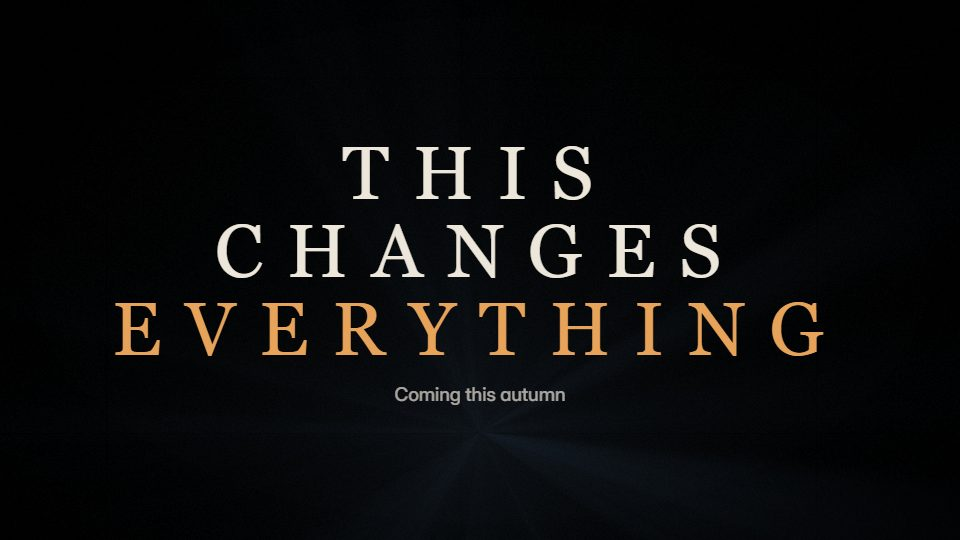

# Epic title-card trailer

**Feature-film trailer grammar for a brand: letterboxed shots, wide-tracked title cards on black and a rising score** · Fit for our films: **Adapt: needs a small helper or a stylisation** · Live demo: [`demos/demo.html#title-card-trailer`](../demos/demo.html#title-card-trailer)

## The look
A letterboxed frame on black (#000000) with cold blue-grey shots (#2C3A4A) and one warm highlight (#E8A35B); a wide-tracked serif or thin caps for title cards; film grain and a soft vignette.

## How it moves
Shots push in slowly; title cards fade up from black as their letter-spacing tightens; the tempo climbs with the score into a burst of short shots, then silence, then the title.

## Shape of a piece
A quiet line on black, the world, rising stakes over 3 title cards, the burst, silence, the name and date.

## Craft rules
Titles never sit over a busy shot; cards always go on black, and the silence before the title is mandatory.

## Ask for, before building
The stakes in 3 short lines, footage or stills, title and date, score

## Where it fits
Major launch teaser, conference keynote opener, brand manifesto trailer

## Build it with our kit
kinetic text blur and letter-by-letter, real photos, shader grain and rays, camera push, music+SFX

**Small helpers it would want (none built yet; the engine is unchanged):** A letterbox frame preset

## Tuning scale
| Energy | Pace | Camera | Density | Background | Type | Realism | Sound |
|---|---|---|---|---|---|---|---|
| +1 | 0 | +1 | −1 | 0 | +1 | +1 | +2 |

## Our director prompt
Direct this film (or these segments) in the **Epic title-card trailer** style. Follow the script word for word, time everything to the voiceover clock, and show me the storyboard before building.

- **Look:** A letterboxed frame on black (#000000) with cold blue-grey shots (#2C3A4A) and one warm highlight (#E8A35B); a wide-tracked serif or thin caps for title cards; film grain and a soft vignette.
- **Motion:** Shots push in slowly; title cards fade up from black as their letter-spacing tightens; the tempo climbs with the score into a burst of short shots, then silence, then the title.
- **Shape of the piece:** A quiet line on black, the world, rising stakes over 3 title cards, the burst, silence, the name and date.
- **Rules:** Titles never sit over a busy shot; cards always go on black, and the silence before the title is mandatory.
- **Ask me first for:** the stakes in 3 short lines, footage or stills, title and date, score
- **Tuning scale:** Energy +1, Pace 0, Camera +1, Density −1, Background 0, Type +1, Realism +1, Sound +2.
- **Build it with:** kinetic text blur and letter-by-letter, real photos, shader grain and rays, camera push, music+SFX. Keep to the engine's craft rules: one primary mover, scenes that open sparse and build, text that is readable before anything ornamental moves.
