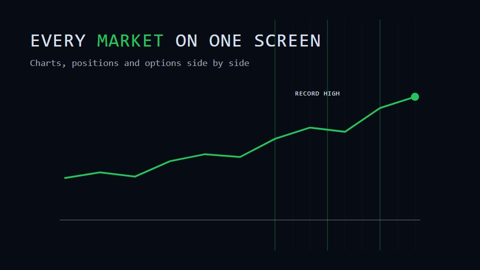

# Trading-desk terminal

**A dense, dark multi-window trading desk that grows from a single dot and zooms between charts, books and watchlists** · Fit for our films: **Adapt: needs a small helper or a stylisation** · Live demo: [`demos/demo.html#trading-desk-terminal`](../demos/demo.html#trading-desk-terminal)

## The look
Ink blue-black panels (#070B14) with hairline borders (#1E2A3D), green up (#22C55E) and red down (#EF4444), tabular mono numerals and small-caps labels; candlesticks, depth bars and a scrolling price tape.

## How it moves
A dot opens into the first window and more panels snap in round it; the camera dives into one figure and back out to the desk, then out until the desk is a point, and back into a mobile view. Prices tick the whole time.

## Shape of a piece
Dot on black, the desk assembles, two dives into key panels, pull out to a point, the single-screen mobile view, name.

## Craft rules
Plausible but clearly demo values; numbers tick at a believable rate and never jitter randomly per frame.

## Ask for, before building
Real screenshots or a panel list, demo data, the screen to end on, compliance disclaimer

## Where it fits
Trading or fintech platform launch, market-data product, financial dashboard promo

## Build it with our kit
screencast windows, data line, bars and counters, camera push-ins and pull-outs, living ground grid

**Small helpers it would want (none built yet; the engine is unchanged):** Candlestick chart and price-tape ticker components

## Tuning scale
| Energy | Pace | Camera | Density | Background | Type | Realism | Sound |
|---|---|---|---|---|---|---|---|
| +1 | +1 | +2 | +2 | −1 | 0 | +1 | 0 |

## Our director prompt
Direct this film (or these segments) in the **Trading-desk terminal** style. Follow the script word for word, time everything to the voiceover clock, and show me the storyboard before building.

- **Look:** Ink blue-black panels (#070B14) with hairline borders (#1E2A3D), green up (#22C55E) and red down (#EF4444), tabular mono numerals and small-caps labels; candlesticks, depth bars and a scrolling price tape.
- **Motion:** A dot opens into the first window and more panels snap in round it; the camera dives into one figure and back out to the desk, then out until the desk is a point, and back into a mobile view. Prices tick the whole time.
- **Shape of the piece:** Dot on black, the desk assembles, two dives into key panels, pull out to a point, the single-screen mobile view, name.
- **Rules:** Plausible but clearly demo values; numbers tick at a believable rate and never jitter randomly per frame.
- **Ask me first for:** real screenshots or a panel list, demo data, the screen to end on, compliance disclaimer
- **Tuning scale:** Energy +1, Pace +1, Camera +2, Density +2, Background −1, Type 0, Realism +1, Sound 0.
- **Build it with:** screencast windows, data line, bars and counters, camera push-ins and pull-outs, living ground grid. Keep to the engine's craft rules: one primary mover, scenes that open sparse and build, text that is readable before anything ornamental moves.
