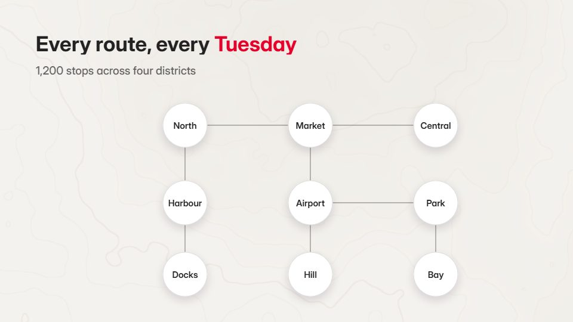

# Transit-line route map

**A light, clean city map with coloured transit-style lines: zoom from districts into one route and ride along it** · Fit for our films: **Adapt: needs a small helper or a stylisation** · Live demo: [`demos/demo.html#transit-route-map`](../demos/demo.html#transit-route-map)

## The look
Light map ground (#F4F2EE) with pale streets (#E2DED6), soft blue water (#CFE3EF) and bold route lines in transit colours (#E4002B, #0072CE, #00A651, #FFB81C); round station dots; a rounded grotesque for labels.

## How it moves
Start high over the whole area, districts light in turn, then zoom into one route; vehicles move along it and slow when the camera is close so street detail can be read; pull out to the full network.

## Shape of a piece
The whole map, districts introduced, zooms into 2-3 routes with one fact each, the network running, the line.

## Craft rules
Lines follow a 45/90-degree grid like a transit diagram; one route is highlighted at a time.

## Ask for, before building
The area, routes or locations, a fact per route, brand colours

## Where it fits
Logistics or delivery coverage, mobility or field-service product, regional expansion, store network

## Build it with our kit
shader topo ground (as terrain), hand-drawn strokes (routes), camera push and travel, data notes

**Small helpers it would want (none built yet; the engine is unchanged):** A path-follow helper whose speed is tied to zoom

## Tuning scale
| Energy | Pace | Camera | Density | Background | Type | Realism | Sound |
|---|---|---|---|---|---|---|---|
| −1 | −1 | +2 | +1 | 0 | −1 | 0 | −1 |

## Our director prompt
Direct this film (or these segments) in the **Transit-line route map** style. Follow the script word for word, time everything to the voiceover clock, and show me the storyboard before building.

- **Look:** Light map ground (#F4F2EE) with pale streets (#E2DED6), soft blue water (#CFE3EF) and bold route lines in transit colours (#E4002B, #0072CE, #00A651, #FFB81C); round station dots; a rounded grotesque for labels.
- **Motion:** Start high over the whole area, districts light in turn, then zoom into one route; vehicles move along it and slow when the camera is close so street detail can be read; pull out to the full network.
- **Shape of the piece:** The whole map, districts introduced, zooms into 2-3 routes with one fact each, the network running, the line.
- **Rules:** Lines follow a 45/90-degree grid like a transit diagram; one route is highlighted at a time.
- **Ask me first for:** the area, routes or locations, a fact per route, brand colours
- **Tuning scale:** Energy −1, Pace −1, Camera +2, Density +1, Background 0, Type −1, Realism 0, Sound −1.
- **Build it with:** shader topo ground (as terrain), hand-drawn strokes (routes), camera push and travel, data notes. Keep to the engine's craft rules: one primary mover, scenes that open sparse and build, text that is readable before anything ornamental moves.
