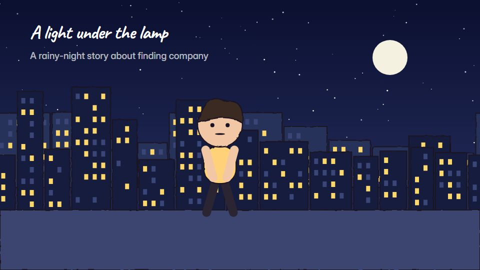

# Watercolour storybook world

**A soft watercolour-and-crayon picture world where one warm light carries the feeling** · Fit for our films: **Adapt: needs a small helper or a stylisation** · Live demo: [`demos/demo.html#watercolour-storybook`](../demos/demo.html#watercolour-storybook)

## The look
Watercolour washes that bleed at the edges (#9FB8C9, #E8C7A5, #6B7FA0) with crayon outlines and pencil shading; one glowing warm light (#FFD27A) as the emotional centre; paper texture throughout; rounded hand lettering.

## How it moves
Washes bloom in as scenes appear, rain or snow drifts in layers, the character walks with a slight line wobble; the camera pans slowly and the light grows as the story resolves.

## Shape of a piece
A quiet, lonely opening, the hero finds something, a friend arrives, the moment of warmth, the closing page.

## Craft rules
Colour starts muted and warms as the story does; one warm light source carries the emotion.

## Ask for, before building
Script, protagonist, setting, the warm turning point, palette

## Where it fits
Brand story with heart, charity or impact film, customer anniversary, holiday film

## Build it with our kit
hand-drawn strokes, living ground washes, shader grain, camera with parallax, music

**Small helpers it would want (none built yet; the engine is unchanged):** A watercolour bleed-edge mask; a crayon line texture

## Tuning scale
| Energy | Pace | Camera | Density | Background | Type | Realism | Sound |
|---|---|---|---|---|---|---|---|
| −1 | −1 | 0 | 0 | +1 | −1 | −1 | 0 |

## Our director prompt
Direct this film (or these segments) in the **Watercolour storybook world** style. Follow the script word for word, time everything to the voiceover clock, and show me the storyboard before building.

- **Look:** Watercolour washes that bleed at the edges (#9FB8C9, #E8C7A5, #6B7FA0) with crayon outlines and pencil shading; one glowing warm light (#FFD27A) as the emotional centre; paper texture throughout; rounded hand lettering.
- **Motion:** Washes bloom in as scenes appear, rain or snow drifts in layers, the character walks with a slight line wobble; the camera pans slowly and the light grows as the story resolves.
- **Shape of the piece:** A quiet, lonely opening, the hero finds something, a friend arrives, the moment of warmth, the closing page.
- **Rules:** Colour starts muted and warms as the story does; one warm light source carries the emotion.
- **Ask me first for:** script, protagonist, setting, the warm turning point, palette
- **Tuning scale:** Energy −1, Pace −1, Camera 0, Density 0, Background +1, Type −1, Realism −1, Sound 0.
- **Build it with:** hand-drawn strokes, living ground washes, shader grain, camera with parallax, music. Keep to the engine's craft rules: one primary mover, scenes that open sparse and build, text that is readable before anything ornamental moves.
