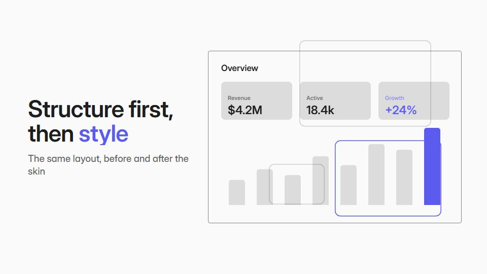

# Wireframe-to-skin reveal

**Each beat is first built as a grey wireframe (boxes, outlined text, guides), then the finished design skins over it without anything moving** · Fit for our films: **Ready: our kit builds it today** · Live demo: [`demos/demo.html#wireframe-to-skin`](../demos/demo.html#wireframe-to-skin)

## The look
Wireframe stage in white (#FAFAFA) with mid-grey boxes (#BDBDBD), dashed guides (#7C7C7C) and outlined type; the skinned state in full brand colour (#5B5BF0); an optional split with final on one side, wireframe on the other.

## How it moves
Boxes draw and snap to guides, outlined text sits in place, then colour, imagery and real type wipe over the exact same layout; at times the frame splits to show both states at once.

## Shape of a piece
The beat as wireframe, the skin wipe, repeat for 3-5 beats, a split of final against structure, sign-off.

## Craft rules
The skin never moves an element: exact alignment between wireframe and final is the whole effect.

## Ask for, before building
The beats and headlines, the design system (colours, type), final screens or mockups

## Where it fits
Design or agency process film, product redesign launch, design-system announcement

## Build it with our kit
screencast windows and buttons, kinetic text mask wipe, hand-drawn strokes (guides), living ground grid

**Small helpers it would want (none built yet; the engine is unchanged):** An outlined-text style; a split-view wipe

## Tuning scale
| Energy | Pace | Camera | Density | Background | Type | Realism | Sound |
|---|---|---|---|---|---|---|---|
| −1 | 0 | −1 | 0 | −1 | 0 | 0 | −1 |

## Our director prompt
Direct this film (or these segments) in the **Wireframe-to-skin reveal** style. Follow the script word for word, time everything to the voiceover clock, and show me the storyboard before building.

- **Look:** Wireframe stage in white (#FAFAFA) with mid-grey boxes (#BDBDBD), dashed guides (#7C7C7C) and outlined type; the skinned state in full brand colour (#5B5BF0); an optional split with final on one side, wireframe on the other.
- **Motion:** Boxes draw and snap to guides, outlined text sits in place, then colour, imagery and real type wipe over the exact same layout; at times the frame splits to show both states at once.
- **Shape of the piece:** The beat as wireframe, the skin wipe, repeat for 3-5 beats, a split of final against structure, sign-off.
- **Rules:** The skin never moves an element: exact alignment between wireframe and final is the whole effect.
- **Ask me first for:** the beats and headlines, the design system (colours, type), final screens or mockups
- **Tuning scale:** Energy −1, Pace 0, Camera −1, Density 0, Background −1, Type 0, Realism 0, Sound −1.
- **Build it with:** screencast windows and buttons, kinetic text mask wipe, hand-drawn strokes (guides), living ground grid. Keep to the engine's craft rules: one primary mover, scenes that open sparse and build, text that is readable before anything ornamental moves.
