# What the kit can draw

Every picture on this page is a frame from a real render: the two films, or the two gallery reels in
[`films/_gallery/`](../films/_gallery/README.md). The calls under each one are what a film's code writes. All of it
runs on one runtime ([`engine/runtime/film.js`](../engine/runtime/film.js)), where every frame is a pure function of
time.

A film uses an optional helper only when a segment calls for it. The craft rules in [ENGINE.md](../ENGINE.md) apply
to all of them: one primary mover, scenes that open sparse and build, and a background that moves with the story.

## Kinetic text

Text sits in grid slots. Each line has its own spoken time and its own entrance and exit.
- **Entrances:** rise, drop, left, right, pop, blur, mask, word by word, words from alternating sides, letter by letter.
- **Exits:** lift, drop, blur, left, right, mask, scale.

A word swap keeps the shared words and rolls in only the new part. From [`engine/kit/text.js`](../engine/kit/text.js).

<table><tr>
<td width="33%">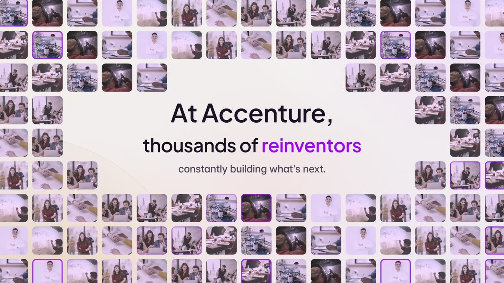<br><sub>Centred, letter by letter, over a mosaic of real people</sub></td>
<td width="33%">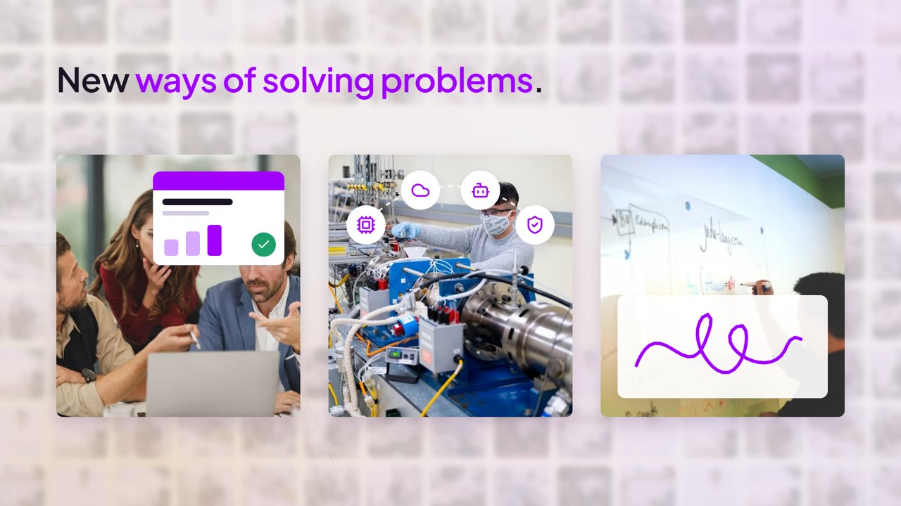<br><sub>A word swap: "New <i>solutions</i>" rolls to "<i>capabilities</i>", then "<i>ways of solving problems</i>"</sub></td>
<td width="33%">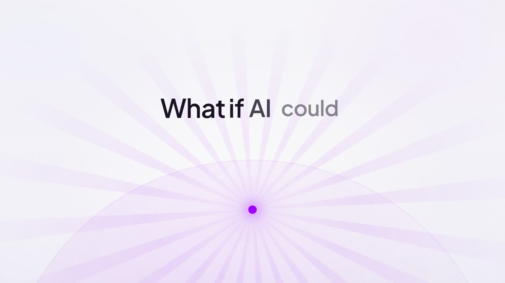<br><sub>Word by word: "What if AI could…"</sub></td>
</tr></table>

```js
// from films/motionlab (times come from the voiceover clock)
KT(layer, 'C', [{ t: 'At Accenture,', role: 'state', at: .05, mode: 'letters' }, …]);
KTswap(layer, { x: 120, y: 120, w: 1680 }, { prefix: 'New', items: [{ t: '*solutions*.', at: FT[0] },
  { t: '*capabilities*.', at: FT[1] }, { t: '*ways of solving problems*.', at: FT[2] }], tout: S1('s02') - .2 });
```

## The living ground

The background is never flat or frozen. It has keyframes per section:
- a base gradient and light;
- three drifting colour washes and an arc;
- one story texture at a time: dots, grid, studio floor, rings, rays, waves, contours or floating frames;
- light sweeps at chosen moments, a vignette and grain.

From [`engine/kit/ground.js`](../engine/kit/ground.js).

<table><tr>
<td width="33%"><br><sub>Rays, for "what if…"</sub></td>
<td width="33%">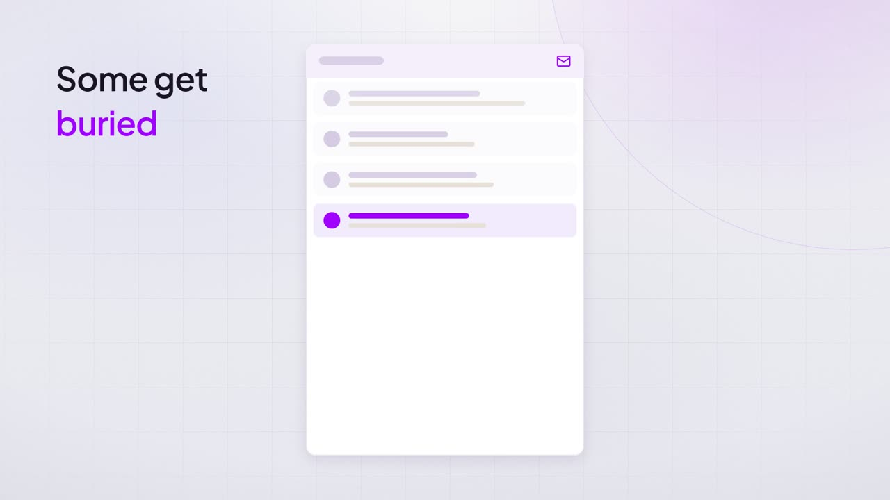<br><sub>A cool grid, for "some get buried"</sub></td>
<td width="33%">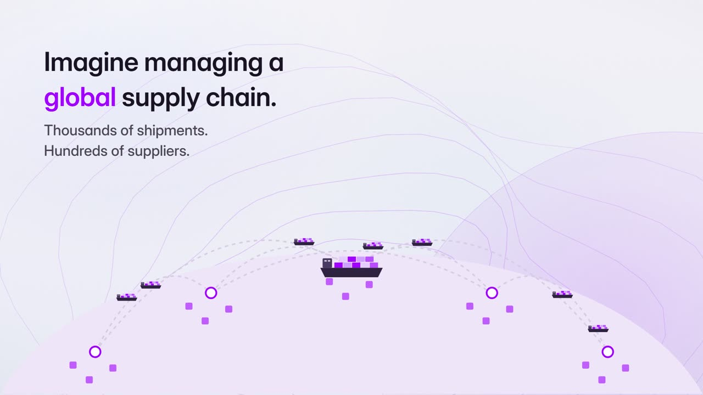<br><sub>Contours, for "a global supply chain"</sub></td>
</tr></table>

```js
VGEGround.live(frame, [
  { t: 0, w1a: .16, pDots: .8 },                       // section 1: warm washes, a dot texture
  { t: 15.5, d: 1.4, pDots: 0, pGrid: .9, ang: 180 },  // section 2: the texture changes with the story
], { sweeps: [15.6] });
```

## Shader backgrounds

Full-screen WebGL backgrounds timed by the film clock, so every frame is deterministic. They render at half
resolution because they are soft fields. The GLSL is our own; the looks follow ShaderGradient, Paper Shaders, Vanta
and React Bits. Rules: [treatments/shader-grounds.md](treatments/shader-grounds.md). From
[`engine/kit/shader.js`](../engine/kit/shader.js).

<table>
<tr>
<td width="25%">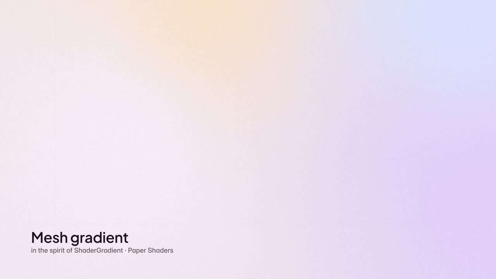<br><sub><code>mesh</code>: openings, product moments</sub></td>
<td width="25%">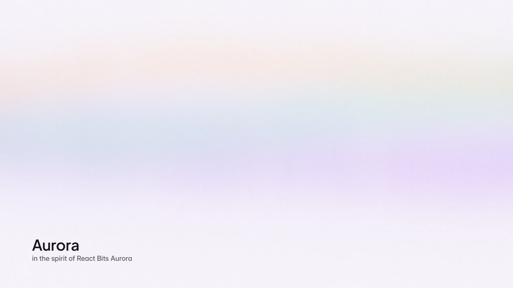<br><sub><code>aurora</code>: a turn, an idea arriving</sub></td>
<td width="25%">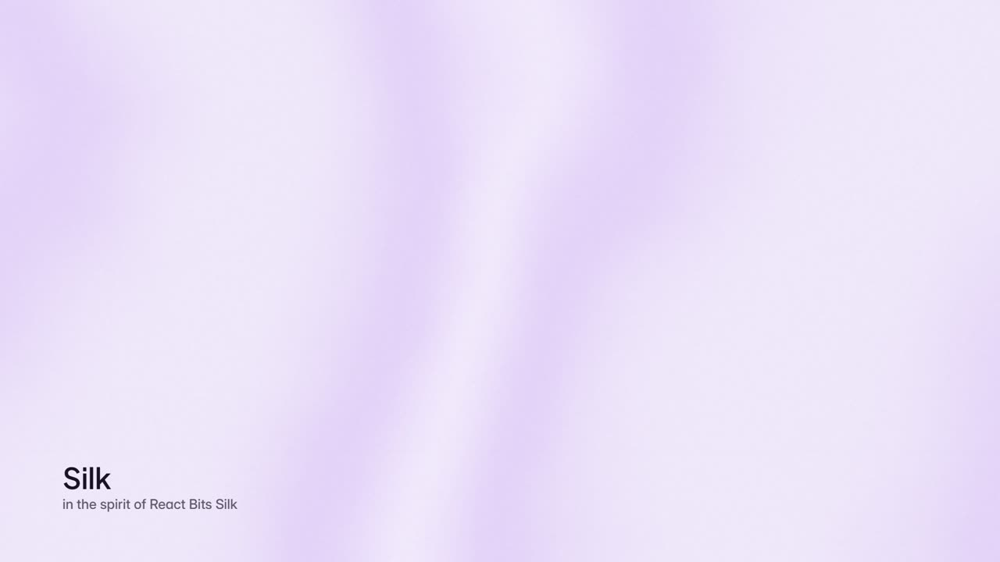<br><sub><code>silk</code>: elegance, a calm close</sub></td>
<td width="25%">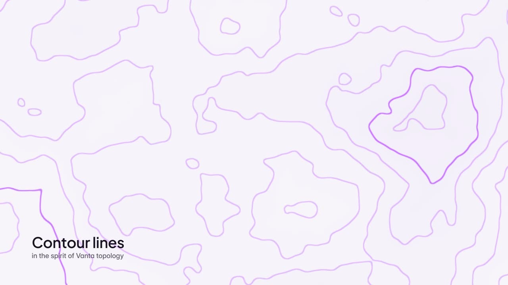<br><sub><code>topo</code>: the world, scale, data</sub></td>
</tr>
<tr>
<td>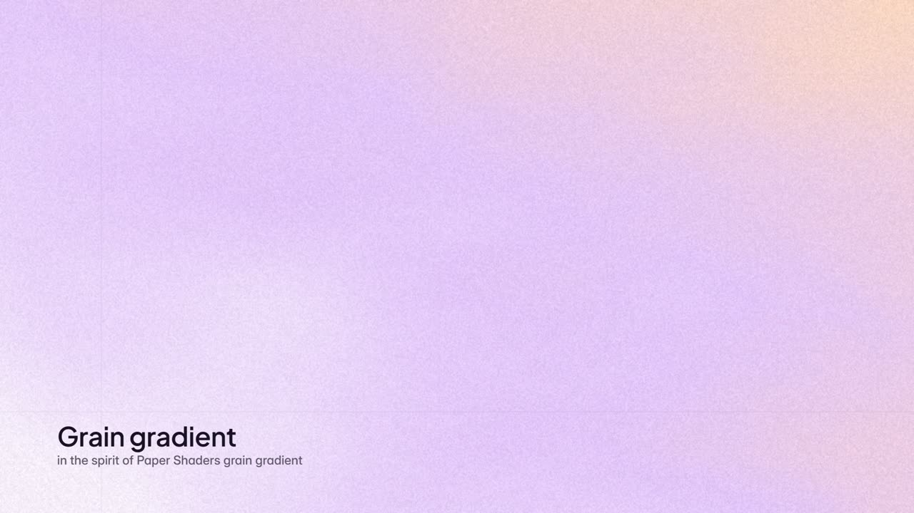<br><sub><code>grain</code>: warm, human sections</sub></td>
<td>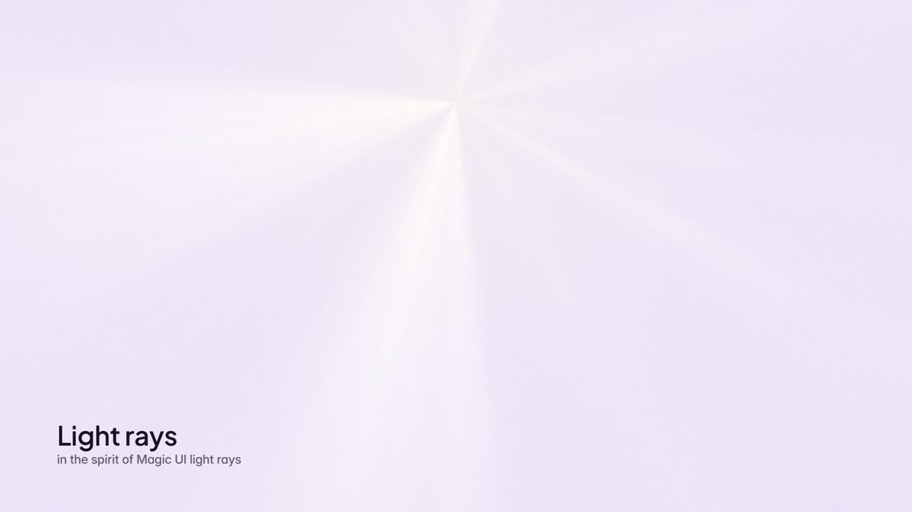<br><sub><code>rays</code>: a reveal, a spotlight</sub></td>
<td>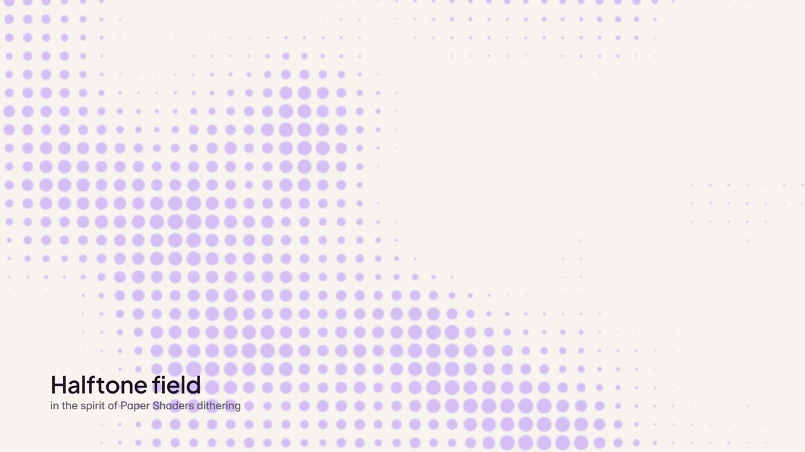<br><sub><code>halftone</code>: tech, systems, texture behind UI</sub></td>
<td>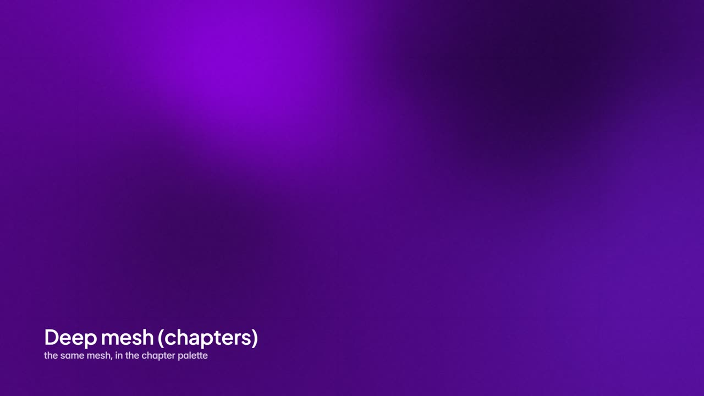<br><sub><code>mesh</code> in the deep palette, for chapters</sub></td>
</tr>
</table>

```js
VGEShader.layer(frame, { effect: 'aurora', colors: ['#F6F3FA', '#D9BDF8', '#C3EBE0', '#FCDCC0'],
  keys: [{ t: 0, a: 0, i: .6 }, { t: 4.2, a: 1, d: 1.2 }] });   // a = opacity, i = intensity, s = scale, v = speed
```

## Treatments for single segments

These follow lemo-opuscar's styles (MIT, pinned in [`third_party/lemo-opuscar/`](../third_party/lemo-opuscar/)).
Each has a rules page in [treatments/](treatments/README.md).

<table><tr>
<td width="50%">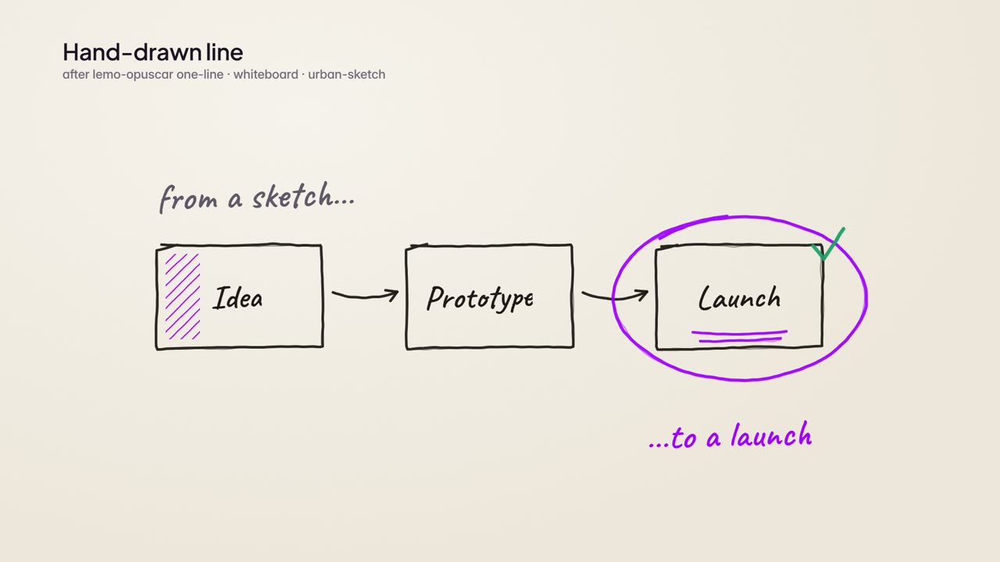<br><sub><b>Hand-drawn line</b>: ink that draws on with a hand wobble, and handwriting that writes on (<a href="../engine/kit/sketch.js">sketch.js</a>)</sub></td>
<td width="50%">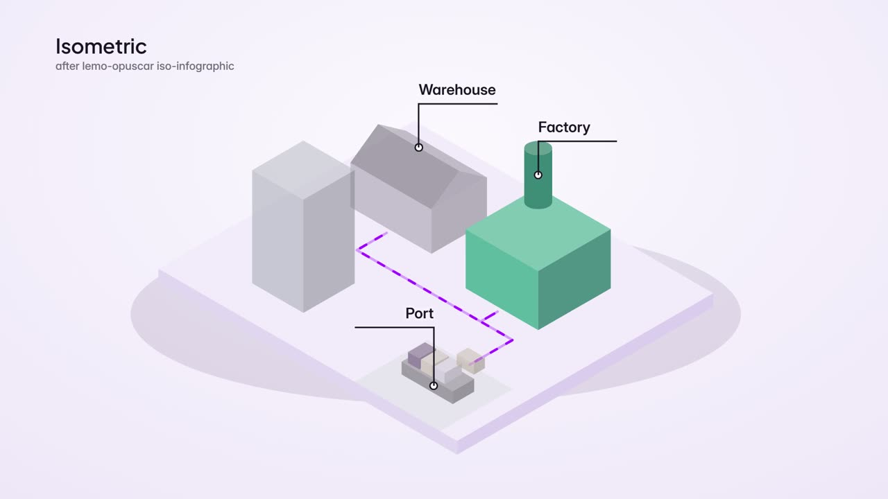<br><sub><b>Isometric</b>: a system as a true-isometric diorama. Solids grow or drop in, a route draws and a truck runs it (<a href="../engine/kit/iso.js">iso.js</a>)</sub></td>
</tr><tr>
<td>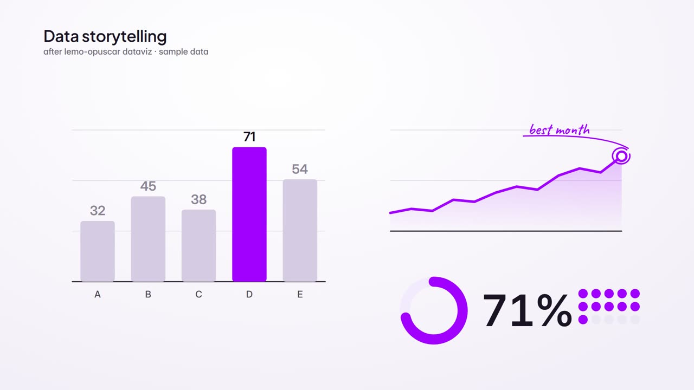<br><sub><b>Data storytelling</b>: charts drawn as they are spoken, with one highlighted mark and notes pinned to marks (<a href="../engine/kit/data.js">data.js</a>; sample data)</sub></td>
<td>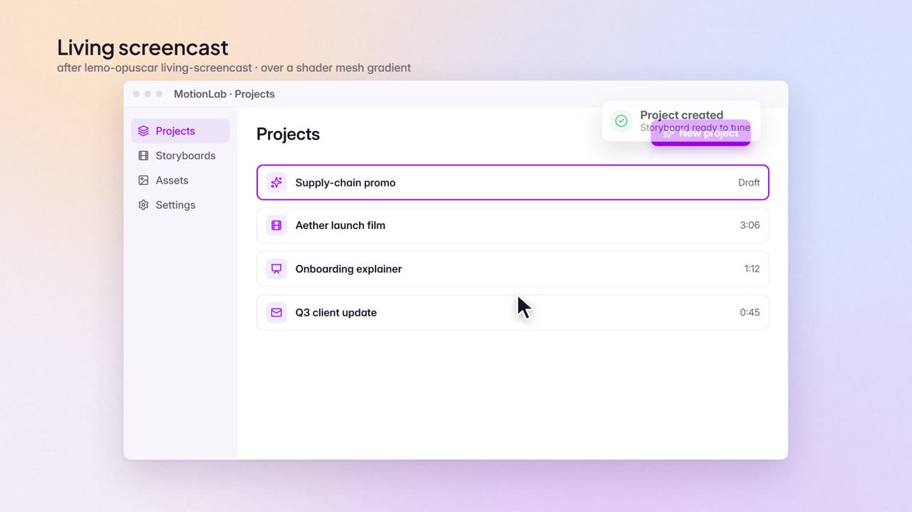<br><sub><b>Living screencast</b>: a product walkthrough redrawn in HTML, with a cursor that clicks and real state changes (<a href="../engine/kit/screen.js">screen.js</a>)</sub></td>
</tr></table>

```js
// hand-drawn line
VGESketch.rect(svg, 300, 470, 320, 200, { t0: .4, seed: 3 });
VGESketch.arrow(svg, 640, 560, 762, 560, { t0: 1.6, bend: .22 });
VGESketch.write(layer, { x: 340, y: 538, text: 'Idea', size: 64, t0: 1.1 });

// isometric
const I = VGEIso.scene(svg, { ox: 900, oy: 380 });
I.box({ x: 300, y: 10, w: 170, d: 170, h: 120, color: '#5FBF9F', t0: 8.1 });
I.route({ points: [[95, 160, 0], [385, 230, 0], [460, 330, 0]], t0: 9.6, dur: 1.2 });

// data storytelling
const b = VGEData.box(200, 360, 700, 420, 0, 80);
VGEData.axes(svg, b, { t0: 14.3 });
VGEData.bars(svg, b, [32, 45, 38, 71, 54], { t0: 14.6, highlight: 3 });
VGEData.counter(layer, { x: 1330, y: 800, to: 71, fmt: (v) => Math.round(v) + '%', t0: 18.3 });

// living screencast
const W = VGEScreen.window(stage, { x: 260, y: 170, w: 1400, h: 800, title: 'Projects', t0: 21.2 });
VGEScreen.button(W.body, { x: 1110, y: 26, text: 'New project', primary: true, t0: 21.6, press: 22.75 });
VGEScreen.cursor(stage, [{ t: 21.8, x: 1500, y: 900 }, { t: 22.7, x: 1460, y: 250, click: true }]);
VGEScreen.camera(stage, [{ t: 0, x: 960, y: 540, s: 1 }, { t: 26.1, x: 1300, y: 330, s: 1.35, d: 1 }]);
```

## Continuity moves

Every boundary between segments is one of six named moves: **Swap, Build, Travel, Gather, Become** or **Chapter**,
each with a reason. Two of them, from the films:

<table><tr>
<td width="50%">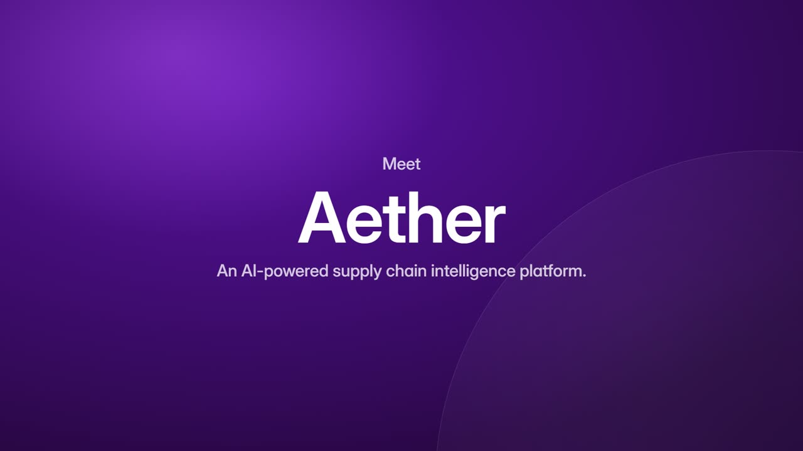<br><sub><b>Chapter</b>: a deep-purple disc grows out of the arc and opens a new act ("Meet Aether")</sub></td>
<td width="50%">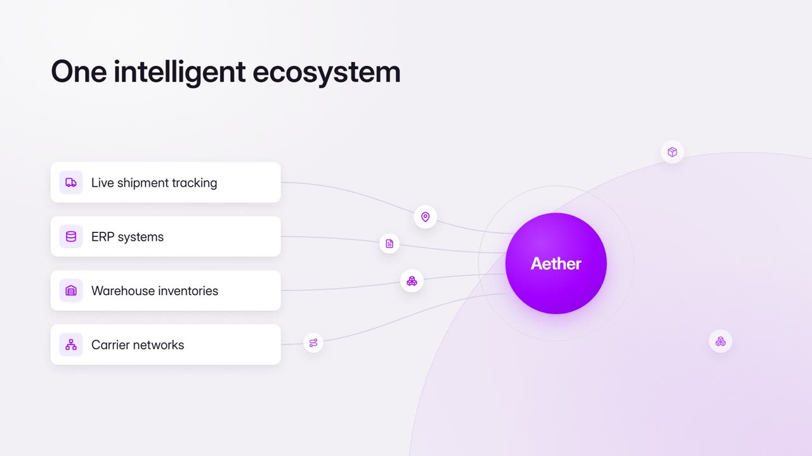<br><sub><b>Gather</b>: four inputs arrive one per mention, and their data gathers into the hub on "one intelligent ecosystem"</sub></td>
</tr></table>

```js
V.disc(chap, [{ r: 0, cx: 1840, cy: 1160 }, { t: 12.8, r: 2400, d: 1.1 }, …]);     // Chapter: the disc grows (films/aether)
V.camera(world, [{ t: 0, x: 0, y: 0, s: 1 }, …, { t: 24.4, x: X.H + 480, d: 1.2 }]); // Travel: the camera follows the line
```
